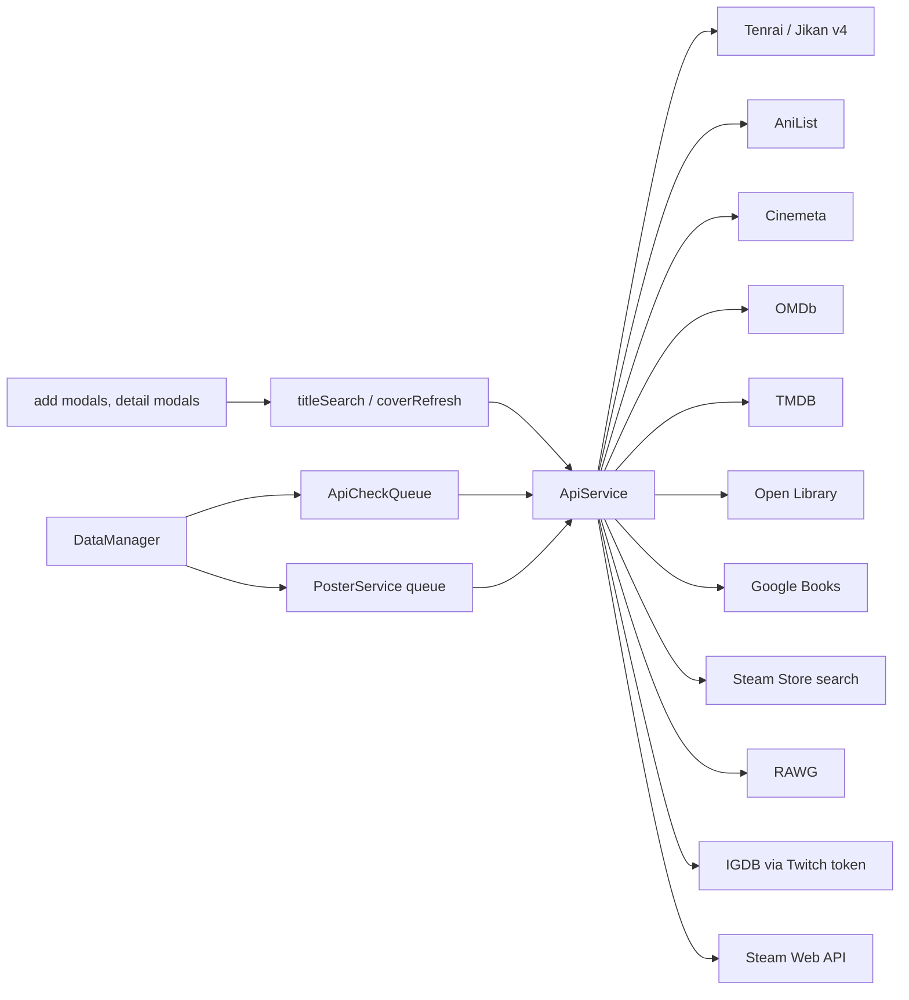

# API layer

Search, autofill, posters and covers work without a key: Cinemeta (movies/TV), Open Library
(books) and the Steam Store (games) are keyless defaults. Community ratings, airing, season refill,
collections and movie/TV studios need keys. APIs fill in posters, covers, episode
counts, release dates, ratings and airing pointers. All of it is **regenerable** and lands in the
[entry cache](../concepts/entry-cache.md), never in a note, except the poster URL (E12) and
user-chosen values.

## ApiService

One class ([ApiService.ts](../../src/ApiService.ts)) holding the keys and every request method,
grouped by service: anime (`searchAnime` via the Jikan-compatible endpoint, `searchAniList`,
`fetchAiring`), movies/TV (`searchOmdb`, `searchTmdb`, details, seasons, collections, `findTmdbMovieIdByImdbId`),
books (`searchGoogleBooks`), manga (`searchManga`, `getMangaByMalId`), games (`searchRawgGames`,
`searchIgdbGames`, details), Steam (`resolveSteamId`, `getSteamOwnedGames`). Keyed services have a
`check*Connection` for the Settings "Test" button and `has*Key` guards. Keys reach it through
`applyApiKeys` in [main.ts](../../src/main.ts) on every `loadSettings` / `saveSettings`, so a restored
backup or a WatchLog import takes effect without a restart; the Settings tab also sets them directly.

- Requests go through `requestVia` with Obsidian's `requestUrl`, `throw: false`, a timeout, and a
  classifier that maps status and body to `ApiError { source, reason }` (reasons: `no-key`, `auth`, `not-enabled`,
  `rate-limited`, `not-found`, `server`, `http`, `parse`, `network`). `apiErrorMessage` / `apiErrorShort` turn that into one user-facing wording via `t('notices.api.*')` ([i18n](i18n.md)); `ApiError` messages themselves stay English, for developers.
- **Keyless sources** need no credential and are never reported as `auth`. Their request URLs and
  response mappers are pure modules, so the service methods are one `request` plus a map:
  [cinemetaApi.ts](../../src/cinemetaApi.ts) (`searchCinemeta`, `getCinemetaDetails`; rows carry
  an IMDb id, a poster and the start year; details add seasons from `videos`, runtime and credits;
  a meta record without a top-level `year` is foreign (Cinemeta answers a wrong-kind id with an
  unrelated title) and maps to `null`),
  [openLibraryApi.ts](../../src/openLibraryApi.ts) (`searchOpenLibrary`, `getOpenLibraryWork`; a
  work id `OL…W`, cover by `cover_i`) and [steamStoreApi.ts](../../src/steamStoreApi.ts)
  (`searchSteamStore`, `getSteamStoreDetails` = the existing `getSteamAppDetails` mapped to a game;
  also `steamLibraryCover`, the portrait capsule). `ApiSource` gained `cinemeta`, `openLibrary`,
  `steamStore` for error wording.
- AniList calls are serialised with a minimum gap; GraphQL errors in a 200 body are detected.
- IGDB needs a Twitch app token (`getIgdbToken`, cached with expiry); a rejected client id/secret
  reports source `twitch`, not `igdb`.
- The Jikan endpoint is configurable ([jikanBase.ts](../../src/jikanBase.ts)): https only, optional
  Basic auth from the URL, Tenrai as default, credentials never sent to Tenrai.
- URLs from responses pass `httpsOrEmpty` before they are stored.
- Search limits: 9 results per page, 3 pages (`SEARCH_RESULT_LIMIT`); year filters accept only a
  plain 4-digit year.

## Routing

[apiSources.ts](../../src/apiSources.ts) is the one resolver: `effectiveMediaSource`,
`effectiveBookSource`, `effectiveGameSource` return the chosen source (`activeApi`,
`booksApiSource`, `gamesApiSource`) if it is keyless or its key is set, else the keyless one
(Cinemeta, Open Library, Steam). Nothing is migrated: an old `activeApi: 'OMDb'` without a key just
resolves to Cinemeta. Every reader goes through it, never through the raw setting.

- [titleSearch.ts](../../src/titleSearch.ts): `getApiGroupForType(type, typeApiMapping)` → anime
  (Jikan or AniList by `animeApiSource`) or movie/series by the effective media source (Cinemeta,
  OMDb, TMDB; `fetchMediaDetails` follows the same). `resultIdKeys` takes that source, because
  `imdbId` on a row is a TMDB id under TMDB.
- [coverRefresh.ts](../../src/coverRefresh.ts): `searchBooks` (Google Books or Open Library) and
  `resolveGameCover` (stored id → that source, else title search in the effective game source);
  reading covers by Open Library, Google Books or MAL id. Bulk refresh needs an id (Google-only
  books also need a key).
- Add modals call the resolver directly for book and game search; `AddFromUrlModal` resolves an
  IMDb link through the effective source (Cinemeta: series first, then movie — the movie endpoint
  returns an unrelated film for many series ids, the series endpoint returns `{}` for movie ids).

## Background work

- [PosterService](../../src/PosterService.ts): a serial queue with per-service delays (none for a title that
  sent no request, e.g. one whose lookup is not due); movie/TV
  order is TMDB key → OMDb key → Cinemeta (by IMDb id, else title search with year; with no kind signal
  series before movie; a 404 for one kind goes on to the other, then to the search), regardless of
  `activeApi`; the `ApiService` for Cinemeta arrives through the injected `getApi` from `main.ts`.
  A found poster is written by `DataManager.updatePosterUrl` into the note only when the note has none
  (or always on explicit refresh); any other outcome is recorded as a lookup check (see
  [lookup results](#lookup-results-and-fetch-state)), so a bad key or an offline moment is a retryable
  `transient`, never "no poster".
- [ApiCheckQueue](../../src/apiCheckQueue.ts): at most 2 parallel tasks, 250 ms apart. Used by
  `DataManager.refillSeasons` and `refreshAiring`; the result (`ok | transient | nokey | notfound`)
  is stamped into `cache.apiCheck` with a per-outcome retry deadline (`apiCheckDue`), and
  `resetNoKeyChecks` re-arms `nokey` checks when a key changes. Community rating, airing, season
  refill and collections stay keyed (OMDb/TMDB/AniList/MAL). `fetchCredits` tries Cinemeta first
  when it is the effective source, else after TMDB/OMDb. The studio lookup of a movie/TV without a
  TMDB key is recorded as `nokey`.

## Lookup results and fetch state

[lookup.ts](../../src/lookup.ts) keeps "nothing found" apart from "failed". A lookup returns a
`LookupResult<T>`: `found { value }`, `notfound`, `failed` or `nokey` (no usable key, so not asked; a title without an id to ask with is `notfound`).
`attempt(call)` adapts one request (a value is `found`, null or `[]` is `notfound`, a throw is `failed`,
or what `onError` makes of it); `lookupOfError` ([ApiService.ts](../../src/ApiService.ts)) is that
`onError` for an `ApiError` (404 is `notfound`, a missing or rejected credential is `nokey`, the rest
`failed`). `firstFound(sources)` runs an ordered list: the first `found` wins, a throwing source counts as
`failed`, `nokey` sources are skipped, and the verdict of the rest is `failed` over `notfound` over `nokey`
(an empty list is `nokey`). Trailer, credits, studio and poster chains and the ID lookups all run through
it; a source reports failure instead of swallowing it in a `catch`.

`checkResultOf` maps a result to the cache's `ApiCheckResult` (`found` records nothing, `notfound` is
`notfound`, `failed` is `transient`, `nokey` is `nokey`) and `DataManager.recordLookup` stamps it into
`apiCheck`. Deadlines, "found is final" and the migration of the old `'none'` markers:
[entry cache](../concepts/entry-cache.md#fetch-state).

Responses are read from `unknown` with the readers of [read.ts](../../src/storage/read.ts) (`readString`,
`readNumber`, `readList`, `at`, ...), never asserted: a field of the wrong type (Jikan `studios: null`, a
TMDB cast item without a name, an AniList `trailer: "x"`) becomes its empty value and the entry is still
built. `no-unsafe-type-assertion` is on for the API modules, so they stay that way
([storage](storage.md#reading-outside-data)).

## Where to change what

- New service: methods in `ApiService` plus `ApiSource`, `apiSourceFromUrl`, a key field and a
  Settings card ([settings](../modules/settings.md)).
- New keyless source: a pure `*Api.ts` mapper module, `ApiSource` + `KEYLESS_SOURCES` +
  `apiSourceFromUrl`, a value in the `apiSources.ts` union and resolver, an [external id](../concepts/external-id.md)
  source and a `LibraryIndex` key.
- New per-type routing: `typeApiMapping` and `getApiGroupForType` in `types.ts`.
