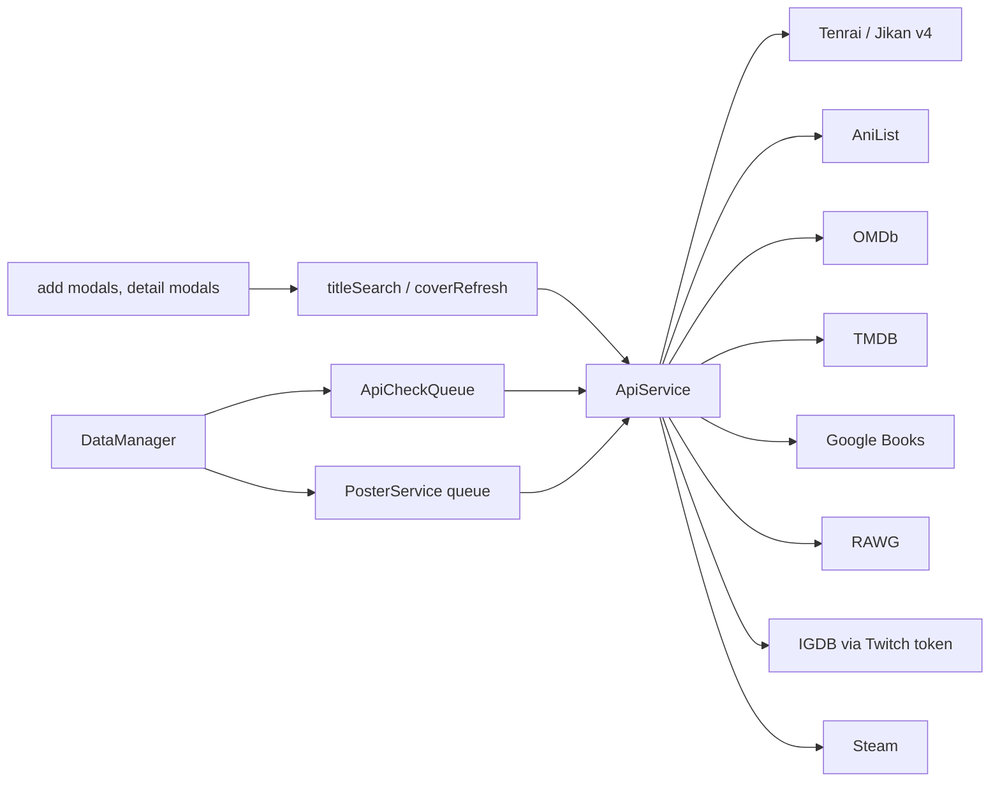

# API layer

Everything works without a key; APIs only fill in posters, covers, episode counts, release dates,
ratings and airing pointers. All of it is **regenerable** and lands in the
[entry cache](../concepts/entry-cache.md), never in a note, except the poster URL (E12) and
user-chosen values.

## ApiService

One class ([ApiService.ts](../../src/ApiService.ts)) holding the keys and every request method,
grouped by service: anime (`searchAnime` via the Jikan-compatible endpoint, `searchAniList`,
`fetchAiring`), movies/TV (`searchOmdb`, `searchTmdb`, details, seasons, collections, `findTmdbMovieIdByImdbId`),
books (`searchGoogleBooks`), manga (`searchManga`, `getMangaByMalId`), games (`searchRawgGames`,
`searchIgdbGames`, details), Steam (`resolveSteamId`, `getSteamOwnedGames`). Each service has a
`check*Connection` for the Settings "Test" button and `has*Key` guards.

- Requests go through `requestVia` with Obsidian's `requestUrl`, `throw: false`, a timeout, and a
  classifier that maps status and body to `ApiError { source, reason }` (reasons: `no-key`, `auth`, `not-enabled`,
  `rate-limited`, `not-found`, `server`, `http`, `parse`, `network`). `apiErrorMessage` / `apiErrorShort` turn that into one user-facing wording.
- AniList calls are serialised with a minimum gap; GraphQL errors in a 200 body are detected.
- IGDB needs a Twitch app token (`getIgdbToken`, cached with expiry); a rejected client id/secret
  reports source `twitch`, not `igdb`.
- The Jikan endpoint is configurable ([jikanBase.ts](../../src/jikanBase.ts)): https only, optional
  Basic auth from the URL, Tenrai as default, credentials never sent to Tenrai.
- URLs from responses pass `httpsOrEmpty` before they are stored.
- Search limits: 9 results per page, 3 pages (`SEARCH_RESULT_LIMIT`); year filters accept only a
  plain 4-digit year.

## Routing

[titleSearch.ts](../../src/titleSearch.ts) picks the service for a watch type:
`getApiGroupForType(type, typeApiMapping)` → anime (Jikan or AniList by `animeApiSource`) or
movie/series (OMDb or TMDB by `activeApi`). [coverRefresh.ts](../../src/coverRefresh.ts) resolves
game covers by stored id, else by title search (RAWG or IGDB), and reading covers by Google Books
or MAL id.

## Background work

- [PosterService](../../src/PosterService.ts): a serial queue with per-service delays; resolves a
  poster, then `DataManager.updatePosterUrl` writes it into the note only when the note has none
  (or always on explicit refresh). A failure is not cached as `'none'`, so a bad key does not burn
  "no poster" into every title.
- [ApiCheckQueue](../../src/apiCheckQueue.ts): at most 2 parallel tasks, 250 ms apart. Used by
  `DataManager.refillSeasons` and `refreshAiring`; the result (`ok | transient | nokey | notfound`)
  is stamped into `cache.apiCheck` with a per-outcome retry deadline (`apiCheckDue`), and
  `resetNoKeyChecks` re-arms `nokey` checks when a key changes.

## Where to change what

- New service: methods in `ApiService` plus `ApiSource`, `apiSourceFromUrl`, a key field and a
  Settings card ([settings](../modules/settings.md)).
- New per-type routing: `typeApiMapping` and `getApiGroupForType` in `types.ts`.
