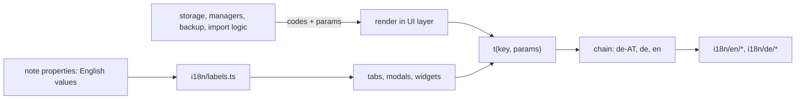

# Internationalisation

Two locales: `en` (source of truth, defines the key type) and `de`. Only the **UI layer** produces
display text; everything below it works with English stored values and **codes**.

## Core: `t(key, params)`

[i18n/index.ts](../../src/i18n/index.ts). `main.ts` calls `setLocale(getLanguage())` first thing in
`onload`. `setLocale` builds the **fallback chain** `[lang, base language, 'en']` (`de-AT` → `de` → `en`;
unknown or missing → `en`). `t` takes the first locale that has the key, so an untranslated `de` key
shows English; a key missing everywhere returns the key itself and never throws.

- `TranslationKey` is derived from the `en` tree: a typo is a compile error.
- `{name}` placeholders come from `params`; unknown ones stay literal.
- **Plurals**: a leaf `{ one, other, zero? }` is chosen by `params.count` via `Intl.PluralRules` of the active
  locale (`zero` only for count 0); no count means `other`.
- Locale trees are one file per area (`common`, `notices`, `settings`, `list`, …) under
  [en/](../../src/i18n/en/index.ts) and [de/](../../src/i18n/de/index.ts). `de` is `DeepPartial` of `en`.

## Adding or changing a string

1. Add the leaf to the matching `src/i18n/en/<area>.ts` (new area: new file, import it in `en/index.ts` and `de/index.ts`).
2. Add the German text under the same path in `de/<area>.ts`; same placeholders, same plural forms.
3. Use `t('area.key', { … })` in the UI. Do not concatenate sentences; give the whole sentence one key.
4. `pnpm test`: the parity test fails when `de` lacks the leaf, has an extra one, differs in placeholders
   or plural shape, or equals the English text (allowlist for cognates and names).
5. ESLint (`recommendedWithLocalesEn` plus the sentence-case rules, see `eslint.config.mjs`) checks the `en` text.

## The label boundary

Stored values (status, type, priority, reading and game status) are English and never change, because
they are the user's data and what hand edits, filters and sync rely on.
[labels.ts](../../src/i18n/labels.ts) (`statusLabel`, `typeLabel`, `readingStatusLabel`,
`gameStatusLabel`, `priorityLabel`, `historyTypeLabel`) is **the only place a stored value becomes display text**; a
user-defined value not in `labels.*` is returned unchanged. Never write a translated label back to a note,
and never compare against one. History.md lines stay English too; the Log tab parses them and runs every
status and bracketed type through these functions.

## Codes, not text, below the UI

The storage and data layers do not import i18n. They return or emit a **code** plus params; the UI layer owns the wording.

| Source | Shape | Rendered by |
|---|---|---|
| Manager and store notices | `ManagerNotice` union in [storageTypes.ts](../../src/storage/storageTypes.ts) (`editLost`, `invalidYaml`, `renameTargetExists`, `apiKeyNeeded`, `episodesLoading`, `sharedConfigUnreadable`) passed through `Notify` | `HoardPlugin.notifyManager` in `main.ts`: `notices.manager.<code>` |
| Shared note writes | [noteWrite.ts](../../src/storage/noteWrite.ts) `updateFrontMatter`, `renameTargetFree` emit notices through `Notify` | same |
| Backup rejection | `BackupErrorCode` from `parseBackup` | settings tab: `settings.backup.restore.errors.<code>` |
| Type-name validation | `typeNameProblem` returns `{ reason, … }` | [problemText.ts](../../src/ui/problemText.ts) |
| API errors | `ApiError.reason` | `apiErrorMessage` / `apiErrorShort` ([API layer](api-layer.md)) |

The WatchLog import logic (`src/import/watchlog/`) has no exception: it returns reports (counts, review items
with paths and a detail `code` + `params`, raw error strings) and the UI layer
([WatchLogOnboardingModal.ts](../../src/WatchLogOnboardingModal.ts), [WatchLogReport.ts](../../src/WatchLogReport.ts))
owns every user-facing word (`onboarding.*` in `en/onboarding.ts`, `de/onboarding.ts`), including the
`WatchLog-Import <date>.md` note, which is rendered in the UI language. Only system error messages stay raw.

## What guards it

- [i18nBoundary.test.ts](../../test/i18nBoundary.test.ts): no file under `src/storage` or `src/import/watchlog`, `types.ts`, the three managers,
  `HistoryManager`, `settingsSplit`, `backup` or `airtimeScheduler` may import `i18n`. Adding text to one of them fails here; return a code instead.
- [i18n.test.ts](../../test/i18n.test.ts): fallback chain, interpolation, plurals, en/de parity (see above).
- `i18nLabels.test.ts` covers the label mapping; the `*I18n.test.ts` files render each area in both locales.

Related: [overview](overview.md), [storage](storage.md), [UI kit](ui-kit.md), [backup](../modules/backup.md).
