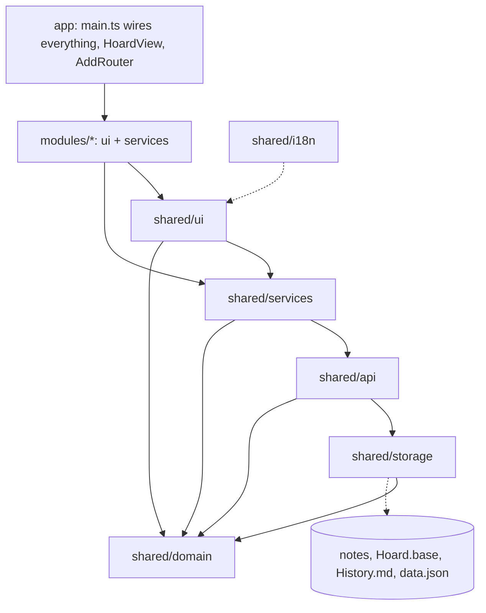

# Overview

Hoard is one Obsidian plugin package. `src/` has three zones: `src/app/` (composition root), `src/modules/<x>/`
(one folder per feature, split into `ui/` and `services/`) and `src/shared/` (`ui`, `services`, `api`, `storage`,
`domain`, `i18n`). The rules below are enforced by tools, not by this page: `.fallowrc.json` (`boundaries`) and
`eslint.config.mjs` are the authority, `test/architecture.test.ts` proves the ESLint rules and the CI job
`rules-changed` flags every change to a rule file in a PR. How to build a module:
`.claude/skills/project/SKILL.md`.

## Zones and rules

- **Shared layer order** (fallow zones, each may import only what is listed): `shared/ui` → services, api, domain,
  i18n; `shared/services` → api, storage, domain, i18n; `shared/api` → storage, domain, i18n; `shared/storage` →
  domain only (free of i18n: [i18n](i18n.md)); `shared/domain` and `shared/i18n` → nothing (leaf zones). `app` may import everything; nothing imports `app`.
- **Module edges** (a module may import only itself, `shared` and the modules listed; anything else fails
  `pnpm quality`). Modules without edges: watchlist, import, log, covers.

  | Module | May import |
  |---|---|
  | airtime, backup, custom-lists, dashboard, drafts | games, reading, watchlist |
  | games, reading | covers, watchlist |
  | widgets | watchlist |
  | settings | backup, covers, custom-lists, games, reading, watchlist |

  Modules form no cycle. Adding an edge means editing `.fallowrc.json` and is a reviewed rule change.
- **Layers inside a module** (ESLint): `ui/` must not import `shared/storage`, `app` or a `services/` file (type-only
  imports are fine; pure helpers belong in `shared/domain`). `services/` must not import UI (`ui/`, `shared/ui`) nor use
  `Modal`, `Notice`, `Setting`, `PluginSettingTab`, `ItemView`, `Menu`; they report codes (`ManagerNotice`) and the UI shows them.
- **Wiring only in app**: `new *Manager` / `new *Service` is an error outside `src/app/`.
- **No inline config**: `eslint-disable` comments in `src/` are errors (`noInlineConfig`). Data layers read outside data from
  `unknown` (`no-unsafe-type-assertion`, see [storage](storage.md)).

## Injection and ports

Every class or function declares in its own file a `<Name>Deps` interface with exactly what it needs, as the *shape*
(`Pick<DataManager, 'getTitles'>`, small functions such as `registerEvent`), not as `HoardPlugin`. A parent's deps
extend its children's and forward them (a tab opening a modal passes the same deps on). `HoardPlugin` fields are private;
`main.ts` builds the objects and hands each the structural subset.

- **Consumer-owned ports** break module cycles: if A needs something from B and B needs A, the consumer declares its own
  interface in its file and `app` wires the implementation structurally, so no import edge appears. Entry types (`Book`,
  `Game`, …) live in `shared/domain/types.ts`, never in a manager.
- **Settings**: [SettingsService](../../src/shared/services/SettingsService.ts) is the only access. `get()` returns a
  read-only view; `update(fn)` mutates, persists once (date format, type names, API keys, `persistSettings`) and emits the
  change signal once; `stage(fn)` does the same debounced for text typed key by key; `flush()` saves a pending stage on
  unload. The plugin keeps the object as private `state`.
- **Obsidian needs the plugin** (`registerEvent`, `register`, settings tab): inject the `Plugin` type or one bound function.
- **Tests** build classes directly with fakes (`test/fakes`, `test/helpers`), never a faked `HoardPlugin`.

## The change signal

Every manager ends a user write with `notifyListeners()`, which runs its own `onChange` listeners
([changeListeners.ts](../../src/shared/services/changeListeners.ts)). Two channels follow from that:

- **Manager `onChange`** drives the view: `HoardView` registers on the watchlist manager's `onChange`, and tabs (e.g.
  `GamesTab`) on their own manager's; the reading and game managers do not touch the global signal. `HoardView` does
  **not** listen to the global signal.
- **Global signal** `hoard-data-changed` ([changeSignal.ts](../../src/shared/services/changeSignal.ts)), dispatched on the
  **main window's** document by `emitDataChanged()`: `DataManager.notifyListeners` calls it, `SettingsService.update` calls it
  (the `changed` dep), and `main.ts` after adoption/rebuild. Listeners via `onDataChanged`: `WidgetRenderer` (re-renders
  live widgets) and the status bar. Never `activeDocument`: that is the window with focus (the settings window since
  Obsidian 1.15), so a change made there would miss listeners added at load.

External changes (sync, hand edits) arrive through `EntryIndex.onChange` (debounced 150 ms) and end in the same notify.

## Cross-cutting

- Settings are composed from defaults, `data.json`, secret storage and the base; see
  [shared vs local](../concepts/shared-vs-local.md).
- Errors from APIs are classified once (`ApiError`, `apiErrorMessage`); note writes with invalid YAML emit a notice code and skip.
- **Text**: only the UI renders display text. Storage and managers emit codes (`ManagerNotice` through `notifyManager` in
  `main.ts`); `src/shared/i18n/labels.ts` maps stored values; see [i18n](i18n.md).
- Mobile: `Platform.isMobile` toggles `hoard-view--mobile`; card size is per device class (`getCardMinWidth`), card text
  placement per tab (`isCardTextUnder`), both injected from `main.ts`.
- Windows: app-wide state uses the plugin's own window (`window.document`): the change signal and body custom properties such
  as the card size (`applyCardSizeCssVar`), which Obsidian copies from the main body into other windows, never back (host
  behaviour, checked against Obsidian 1.15.0). `activeDocument` is for UI that belongs to the window the user is in.
- Start-up order and the WatchLog wizard: [flows/startup](../flows/startup.md).
