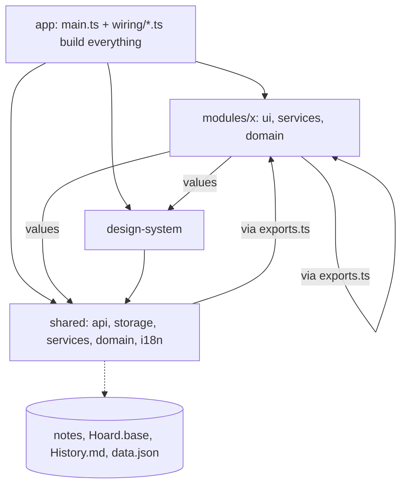

# Overview

Hoard is one Obsidian plugin package. `src/` has four code zones: `src/app/` (composition root), `src/modules/<x>/`
(one folder per feature: `ui/`, `services/`, `domain/`, and `exports.ts` where others need something), `src/design-system/` (the UI kit, see
[ui-kit](ui-kit.md)) and `src/shared/` (`api`, `storage`, `services`, `domain`, `i18n`). The rules below are
enforced by tools, not by this page: `.fallowrc.json` (`boundaries`: which module edges exist) and `eslint.config.mjs`
(`import-x/no-restricted-paths`: that they go through the barrel) are the authority, `test/architecture.test.ts` proves
the ESLint rules and the CI job `rules-changed` flags every change to a rule file
and (step "Flag changes to module exports") to `src/modules/*/exports.ts` or `.fallowrc.json` in a PR. How to build a module: `.claude/skills/project/SKILL.md`.



## Zones and rules

Fallow zones: `app`, one per module (`modules/<x>`), `design-system`, `shared`, plus `test`, `tooling`, `styles`,
`obsidian-mock`. There is no zone for exports: a module's `exports.ts` belongs to the module's zone.

| Zone | Pattern | May import |
|---|---|---|
| `app` | `src/app/**` | every module, `design-system`, `shared` |
| `modules/<x>` (one per module) | `src/modules/<x>/**` | `design-system`, `shared`, and only the other modules it really uses (list per module in `.fallowrc.json`) |
| `design-system` | `src/design-system/**` | `shared` |
| `shared` | `src/shared/**` | `modules/games`, `reading`, `watchlist` (values and types), `airtime`, `drafts`, `settings` (types only) |
| `test` | `test/**` | everything |
| `tooling`, `styles`, `obsidian-mock` | `scripts/**`, `*.mjs`, `vitest.config.ts` / `src/styles/**` / `test/__mocks__/obsidian.ts` | tooling: the mock; the other two: nothing |

- **Module edges are listed, not blanket.** Each module rule names exactly the module edges the code has: `allow` for
  value imports, `allowTypeOnly` for type-only ones (`custom-lists`, `drafts`, `log` and `widgets` have none or only type edges).
  A new edge is a reviewed change to `.fallowrc.json`. fallow judges an import by the file that *defines* the symbol,
  so it cannot see the barrel; that is ESLint's job.
- **The barrel (ESLint `import-x/no-restricted-paths`, `eslint.config.mjs`).** Code outside module `<m>` (other modules,
  `src/shared`, `src/design-system`) reaches `<m>` only through `src/modules/<m>/exports.ts` (imported as `…/<m>/exports`),
  never its `ui/`, `services/` or `domain/`. `src/app/**` and `test/**` are exempt.
- **`exports.ts` is a module's deliberate public surface and only re-exports.** `no-restricted-syntax` allows named
  re-exports from the module's own files (no definitions, no `export *`, no imports, no `../`). The symbols live where
  their domain puts them: models in `domain/model.ts`, constants and pure functions in `domain/*.ts` (`DEFAULT_SETTINGS`,
  `settingsCodec`, `READING_STATUSES`, `titles`, `airtime`, `newTitle`/`newGame`/`newReading`), the **role interfaces** the
  managers `implement` (`TitleReader`, `TitleWriter`, `ReadingReader`, `GameWriter`, `SettingsReader`, `AirtimeReader`,
  `DraftStore`, …) in `services/roles.ts`; `Open<X>` factory types sit with the models. A role lives with its consumer's
  module, not with the implementing manager (`AirtimeReader`/`AirtimeStore` in `airtime`, `DraftStore` in `drafts`;
  `DataManager` implements them). Modules with a surface: airtime, backup, drafts, games, reading, settings, watchlist;
  the others (`custom-lists`, `dashboard`, `log`, `widgets`) have no `exports.ts` because nobody outside imports them.
- **`shared` may import module exports, types and values** (constants, codec reference data): `shared/storage` codecs
  read `settingsDefaults`, `readingDefaults`, `gameDefaults`, `titles` through them. `shared` holds no module logic itself;
  values only one module needs stay in its `domain/`, values two or more modules need (dates, columns,
  tags, `imdb`, `api/credits`, `api/apiGroup.ts`) live in `src/shared/`. The design system imports no module, so it knows no module
  and no settings. Open question (issue #48): where watchlist-only API logic used by several modules belongs (`titleSearch`,
  `getApiGroupForType`, maybe `PosterService`).
- **Exports review**: every line change in an `exports.ts`, every new module edge in `.fallowrc.json` and every new `shared` → exports import goes through
  the read-only agent [exports-reviewer](../../.claude/agents/exports-reviewer.md) before the commit (rule in
  [CLAUDE.md](../../CLAUDE.md)). It pushes back per symbol (outside consumer? owner? kind? width? logic leak?).
  Unresolved challenges go to the user.
- `obsidian-mock` is allowed for modules, the design system and `shared` only as an artifact: fallow resolves
  `obsidian` through the vitest alias to `test/__mocks__/obsidian.ts`.
- **Inside `shared`** fallow draws no lines (one zone). What is kept out of lower layers is guarded by lint and tests:
  no i18n import in storage, domain, `roles.ts`, `exports.ts` or the data managers ([i18n](i18n.md)); the services lint rules below.
- **One zone per module**, declared explicitly (`modules/<x>`), not via `autoDiscover`: `fallow audit` analyses the base
  branch with the current config, and an `autoDiscover` folder the base lacks makes the whole config invalid.
  `coverage.requireAllFiles` fails a new file that belongs to no zone. A new module therefore needs its zone and a
  rule in `.fallowrc.json`, which is a reviewed rule change.
- **Layers inside a module** (ESLint, `src/modules/*/ui/**`): UI must not import `shared/storage`, `app` or a
  `services/` file as a value (type imports are fine; `shared/services` is allowed). Pure helpers belong in
  `shared/domain` or the module's `domain/`.
- **Services** (`src/modules/*/services`, `shared/services`, `shared/storage`, `shared/api`) must not import UI
  (`**/ui/**`, `**/design-system/**`) nor use `App`, `Modal`, `Notice`, `Setting`, `PluginSettingTab`, `ItemView`,
  `Menu` or a namespace/default import of `obsidian`; they report codes (`ManagerNotice`) and the UI shows them.
- **Wiring only in app**: `new *Manager` / `new *Service` is an error outside `src/app/`.
- **No inline config**: `eslint-disable` and `fallow-ignore` comments in `src/` are errors (`noInlineConfig`,
  `scripts/check-eslint-disables.mjs`); fallow exceptions need the maintainer's approval. Data layers read outside data
  from `unknown` (`no-unsafe-type-assertion`, see [storage](storage.md)).

## Modules talk through exports

A module's `exports.ts` is its public surface. A consumer in another module names the **role** it needs, never the
manager class: `DataManager implements TitleReader, TitleStats, TitleWriter, AirtimeStore, DraftStore,
TitleMaintenance, TitleBackup` (`AirtimeStore`, which extends `AirtimeReader`, and `DraftStore` come from the airtime and drafts exports); the reading and game managers implement their `*Reader/Writer/SettingsAccess/Snapshot`
roles; `SettingsService implements SettingsReader, SettingsWriter`. Dashboard, airtime, backup and the others import
these as types (usually `Pick<…>`; constants and pure functions are plain value imports), and `app` hands in the real objects. Inside a module the UI may take its own
manager class by `import type`. Where two managers need each other at runtime, `main.ts` links them with lambdas, so
neither imports the other.

## Injection and ports

Every dependency is a separate `private readonly` constructor parameter; there are no `*Deps` bags and nothing is
called `deps`. Order: `app` (only for Obsidian base classes, passed to `super(app)`), then the collaborators, then
one `opts` object with runtime data (data, never services).

```ts
export type OpenAddReading = (opts: AddReadingOptions) => void; // exported from the child's file

export class AddReadingModal extends Modal {
  constructor(
    app: App,                                  // only for super()
    private readonly settings: SettingsReader, // role from settings/exports.ts
    private readonly reading: ReadingDataManager, // own module: class by import type
    private readonly opts: AddReadingOptions,
  ) { super(app); }
}
```

- **Shape, not origin.** A collaborator is a role from an `exports.ts`, a `Pick<Manager, …>` or a consumer-owned interface,
  not `HoardPlugin`.
- **Children come as factories.** A parent receives `OpenX` function types (exported from the child's file) or, with
  more than three, a methods-only port it owns (`ListTabModals { openDetail(…): void; … }`). It never receives its
  children's dependencies. Recursion (a detail modal opening another) goes through a closure in the wiring.
- **Wiring** lives in `src/app/wiring/<module>.ts` (`watchlistUi(core) → { openAddTitle, openTitleDetail, createListTab }`)
  and is the only place that `new`s UI; `main.ts` builds the core objects and calls the wiring, `hoardTabs`
  (`wiring/tabs.ts`) collects the tabs for `HoardView`.
- **`App` only for `super(app)`** (and inside `src/app`). Everything else gets `Vault`, `Workspace`, `MetadataCache` or a
  `Pick` such as `Pick<FileManager, 'trashFile'>`; helpers take what they need (`confirmWith(app)` returns a `confirm`
  function). This includes the inherited `Modal.app`: no `this.app` in `modules`, `design-system` or `shared`.
- **Shared collaborators are real classes with behaviour** ([EntryNotes](../../src/shared/services/EntryNotes.ts): paths,
  ids, read/write, rename following for the data managers), never tuples or bags of loose functions. A function with
  many collaborators becomes a class built in `app`.
- **Lint guards** (`eslint.config.mjs`, proved in `test/architecture.test.ts`; each message points here): no type named
  `*Deps`, no identifier `deps`, no `this.app` in `modules`/`design-system`/`shared`, no `App` import in services, storage
  and api, no rest parameter in a constructor (a spread tuple of dependencies).
- `HoardPlugin` fields are private; `main.ts` hands each wiring function the structural subset.
- **Settings**: [SettingsService](../../src/modules/settings/services/SettingsService.ts) is the only access. `get()`
  returns a read-only view; `update(fn)` mutates, persists once through the plugin's `persistAll` and emits the change
  signal once; `stage(fn)` does the same debounced for text typed key by key; `flush()` saves a pending stage on
  unload. The plugin keeps the object as private `state`. Exception: backup restore may write
  `local.data.settings` directly and then reload the settings (`loadSettings`).
- **Obsidian needs the plugin** (`registerEvent`, `register`, settings tab): inject the `Plugin` type or one bound function (`EntryNotes` takes `registerEvent`).
- **Tests** build classes directly with fakes (`test/fakes`, `test/helpers`), never a faked `HoardPlugin`.

## The change signal

Every manager ends a user write with `notifyListeners()`, which runs its own `onChange` listeners
([changeListeners.ts](../../src/shared/services/changeListeners.ts)). Two channels follow from that:

- **Manager `onChange`** drives the view: `HoardView` registers on the watchlist manager's `onChange`, and tabs (e.g.
  `GamesTab`) on their own manager's; the reading and game managers do not touch the global signal. `HoardView` does
  **not** listen to the global signal.
- **Global signal** `hoard-data-changed` ([changeSignal.ts](../../src/shared/services/changeSignal.ts)), dispatched on the
  **main window's** document by `emitDataChanged()`: `DataManager.notifyListeners` calls it, `SettingsService.update` calls it
  (its `changed` callback), the settings tab in one place and `main.ts` after adoption/rebuild. Listeners via
  `onDataChanged`: `WidgetRenderer` (re-renders live widgets) and the status bar. Never `activeDocument`: that is the
  window with focus (the settings window since Obsidian 1.15), so a change made there would miss listeners added at load.

External changes (sync, hand edits) arrive through `EntryIndex.onChange` (debounced 150 ms) and end in the same notify.

## Cross-cutting

- Settings are composed from defaults, `data.json`, secret storage and the base; see
  [shared vs local](../concepts/shared-vs-local.md).
- Errors from APIs are classified once (`ApiError`, `apiErrorMessage`); note writes with invalid YAML emit a notice code and skip.
- **Text**: only the UI renders display text. Storage and managers emit codes (`ManagerNotice` through `notifyManager` in
  `main.ts`); `src/shared/i18n/labels.ts` maps stored values; see [i18n](i18n.md).
- Mobile: `Platform.isMobile` toggles `hoard-view--mobile`; card size is per device class (`getCardMinWidth`), card text
  placement per tab (`isCardTextUnder`), both injected from `main.ts`.
- Windows: app-wide state uses the plugin's own window (`window.document`): the change signal and body custom properties such
  as the card size (`applyCardSizeCssVar`), which Obsidian copies from the main body into other windows, never back (host
  behaviour, checked against Obsidian 1.15.0). `activeDocument` is for UI that belongs to the window the user is in.
- Start-up order: [flows/startup](../flows/startup.md). Tracker migration: [flows/migrate-notes](../flows/migrate-notes.md).
