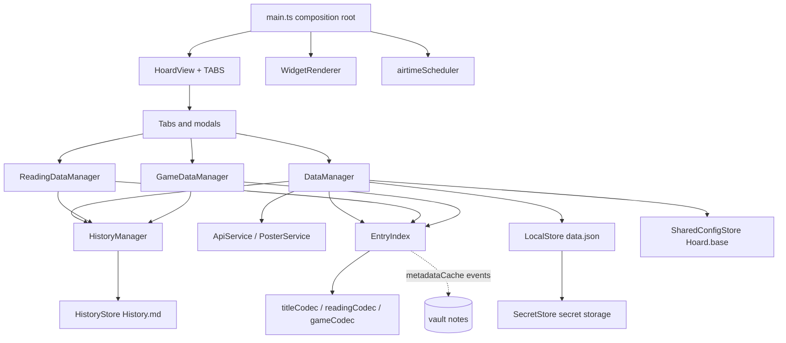

# Overview

Hoard is one Obsidian plugin package (`src/`, flat files plus `storage/`, `ui/`, `csv/`,
`import/watchlog/`). Dependencies point downward; storage knows nothing of managers or UI.
`.claude/skills/project/SKILL.md` states the same layering with naming rules; this page adds the
mechanism.

## Layers

1. **Storage** ([architecture/storage](storage.md)), free of i18n imports ([i18n](i18n.md)): `VaultLayout` (paths and ids), `EntryIndex`
   (read-only map id → entry fed by `metadataCache`), codecs (properties ↔ objects), `LocalStore`
   (`data.json`), `SecretStore` (API keys in Obsidian's secret storage), `SharedConfigStore` (`hoard:` block of `Hoard.base`), `HistoryStore` (`History.md`).
2. **Managers**: [DataManager](../modules/watchlist.md) (titles, groups, Maybe, airtime entries,
   custom-list time lookups), [ReadingDataManager](../modules/reading.md),
   [GameDataManager](../modules/games.md). They own in-memory copies, write notes through
   `processFrontMatter`, log to `HistoryManager`, and notify.
3. **API layer** ([architecture/api-layer](api-layer.md)): `ApiService` (eight services),
   `PosterService`, `ApiCheckQueue`, cover and title search helpers. Called by managers and modals.
4. **UI** ([architecture/ui-kit](ui-kit.md)): `HoardView` with the `TABS` registry, one tab per
   domain, modals, shared pieces in `src/ui/`.
5. **Composition root** `main.ts`: builds everything in field initialisers, loads data, offers the
   [WatchLog import](../modules/import.md) wizard when needed (before indexing), registers view, commands, [widgets](../modules/widgets.md),
   status bar and the scheduler. See [flows/startup](../flows/startup.md).

## The change signal

Every manager ends a user write with `notifyListeners()`: its own `onChange` listeners run, then the
DOM event `hoard-data-changed` is dispatched on `activeDocument`. Consumers: `HoardView`
re-renders the active tab in place (state survives), `WidgetRenderer` re-renders live widgets, the
status bar recounts. External changes (sync, hand edits) arrive through `EntryIndex.onChange`
(debounced 150 ms) and end in the same notify.

## Cross-cutting

- Settings are composed from defaults, `data.json`, secret storage and the base; see
  [shared vs local](../concepts/shared-vs-local.md).
- Errors from APIs are classified once (`ApiError`, `apiErrorMessage`) so every caller shows the
  same wording; note writes with invalid YAML emit a notice code and skip.
- **Text**: only the UI layer renders display text. Storage and managers emit codes (`ManagerNotice`
  through `notifyManager` in `main.ts`), `src/i18n/labels.ts` maps stored values; see
  [i18n](i18n.md).
- Mobile: `Platform.isMobile` toggles `hoard-mobile` on the view; card size is per device class
  (`getCardMinWidth`), card text placement is per tab (`isCardTextUnder`), both in `main.ts`.
