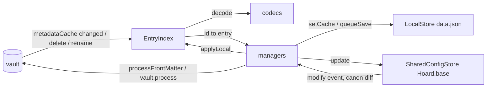

# Storage

**The note is the record.** Everything a user tracks is a Markdown note with properties under one
root; the plugin only adds a shared config file, a log file and a per-device cache.

| File | Owner | Content | Synced |
|---|---|---|---|
| `<root>/<Type>/*.md`, `Books/`, `Manga/`, `Games/` | managers write, `EntryIndex` reads | one entry per note; properties = fields, `## Notes` = free text | yes |
| `<root>/Hoard.base` | `SharedConfigStore` | `hoard:` block with the shared settings; filters/views are Obsidian's | yes |
| `<root>/History.md` | `HistoryStore` | one line per event ([history line](../concepts/history-line.md)) | yes |
| `<root>/CustomLists/*.md` | `CustomListsTab` | Markdown tables ([custom lists](../modules/custom-lists.md)) | yes |
| plugin `data.json` | `LocalStore` | device settings, API keys, [entry cache](../concepts/entry-cache.md), UI state | no |

## Reading: EntryIndex

[EntryIndex.ts](../../src/storage/EntryIndex.ts) scans `vault.getMarkdownFiles()`, classifies each
path with `VaultLayout.classify` ([entry id](../concepts/entry-id.md)), decodes the cached
frontmatter with the matching codec and keeps `id → {entry, invalidFields}`. It never writes a
note; on vault `delete`/`rename` it does drop or re-key the entry's cache in `data.json`.
`metadataCache.changed` upserts (deep-equal check, so echoes of own writes are no-ops, and a
change that only alters unreadable fields is not emitted), and `rebuild()` re-scans after a root
or type-name change. Changes are batched 150 ms and emitted as a set of ids.

Codecs are pure: `decodeTitle(id, properties, cache)` / `encodeTitle`, `decodeBook`/`encodeBook`,
`decodeManga`/`encodeManga`, `decodeGame`/`encodeGame`. Each returns `invalidFields` for values of the
wrong type instead of failing; those properties are left untouched on write. Property names come
only from [properties.ts](../../src/storage/properties.ts) ([property names](../concepts/properties.md)).

## Writing: the managers

A manager encodes the entry, diffs against the [baseline](../concepts/baseline.md) and sets only
changed keys through `app.fileManager.processFrontMatter`; inside the callback it calls
`EntryIndex.applyLocal` so the write's own `changed` event finds nothing new. The `## Notes` body
goes through `vault.process` with `replaceNotesSection` ([noteBody.ts](../../src/storage/noteBody.ts)),
which keeps every other section. Creates use `vault.create` with a `---` block plus `## Notes`;
deletes use `fileManager.trashFile`. Details in [flows/entry-write](../flows/entry-write.md).

## Messages: codes, not text

Stores and managers never build user-facing text. A manager failure (unreadable YAML, rename target
taken, lost edit, unreadable shared block) is a `ManagerNotice` code passed to the injected `Notify`;
[noteWrite.ts](../../src/storage/noteWrite.ts) holds the shared `updateFrontMatter` /
`renameTargetFree` helpers the three managers use. `main.ts` renders the code in the active language
([i18n](i18n.md)).

## Config and cache

- `SharedConfigStore` (takes a `Notify`) reads/writes only the `hoard:` block ([baseFile.ts](../../src/storage/baseFile.ts)
  finds the block by indentation and replaces it line-wise; `ensureFilter` keeps the base's
  `file.inFolder("<root>")` filter pointing at the root). Whitelist and sync rules:
  [shared vs local](../concepts/shared-vs-local.md).
- `LocalStore` is `data.json` schema 2 (`schemaVersion`, `settings`, `cache`, `ui`, optional
  `reading`/`games`/`drafts`). It refuses to write, for the whole session, when the file is a
  WatchLog schema-1 file (device settings and cache then start empty; notes in the vault are indexed as
  usual) or from a newer plugin version; both show a sticky Notice. The per-device WatchLog
  import decision lives in `ui.watchlogImport` ([flows/watchlog-import](../flows/watchlog-import.md)).
- `HistoryStore` appends and caps `History.md`, ignoring its own writes by content.

## Where to change what

- A new note property for titles: `encodeTitle`/`decodeTitle` in
  [titleCodec.ts](../../src/storage/titleCodec.ts), `HoardTitle` in `types.ts`, and `TITLE_CACHE_KEYS`
  if it is API data. Reading and games: their codecs; cache merge does not exist there.
- A new entry kind: `EntryKind`, `FOLDERS` and `classify` in `VaultLayout`, a codec, an `EntryIndex`
  case, a manager.
- A new shared setting: the whitelist in `SharedConfigStore` ([settings](../modules/settings.md)).
