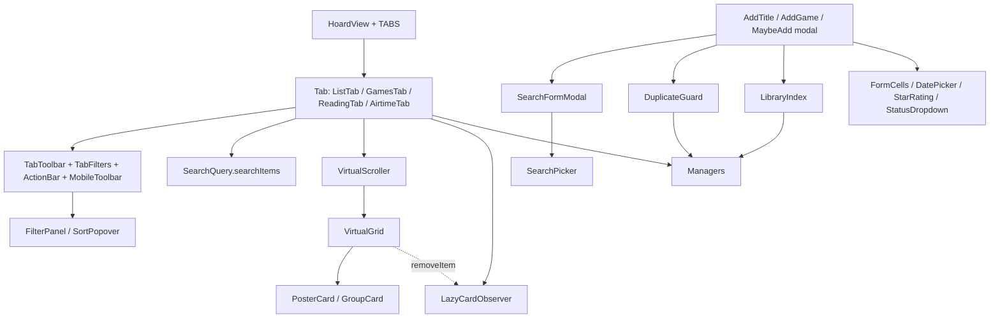

# UI kit

## Purpose / Boundary
Tabs (`ListTab`, `GamesTab`, `ReadingTab`, `AirtimeTab`, ...) and modals are thin; shared behaviour lives in `src/ui/*` and a few top-level helpers. **Boundary:** UI depends on managers (`plugin.dataManager`, `readingDataManager`, `gameDataManager`), never on storage. Verified by grep of `src/storage/` imports outside managers/migration/storage: only `main.ts` (wiring), `settingsSplit.ts`, `backup.ts` (settings persistence), `ApiService.ts` (type `EntryCache`), and two pure-function uses of `VaultLayout` in `SettingsTab.ts` (`typeNameError`) and `CsvModal.ts` (`safeTypeName`). No tab, detail modal or add modal imports a store, codec or index. See [storage](storage.md), [overview](overview.md).

## Entry points
- [HoardView.ts](../../src/HoardView.ts): `HoardView`, the `TABS` registry, `setActiveTab`, `refreshUI`.
- [TabToolbar.ts](../../src/ui/TabToolbar.ts), [TabFilters.ts](../../src/ui/TabFilters.ts), [ActionBar.ts](../../src/ui/ActionBar.ts), [GroupCard.ts](../../src/ui/GroupCard.ts).
- [SearchFormModal.ts](../../src/ui/SearchFormModal.ts), [SearchPicker.ts](../../src/ui/SearchPicker.ts), [DuplicateGuard.ts](../../src/ui/DuplicateGuard.ts), [LibraryIndex.ts](../../src/LibraryIndex.ts).
- [VirtualScroller.ts](../../src/VirtualScroller.ts), [VirtualGrid.ts](../../src/VirtualGrid.ts), [LazyCardObserver.ts](../../src/LazyCardObserver.ts), [PosterCard.ts](../../src/PosterCard.ts).
- [SearchQuery.ts](../../src/SearchQuery.ts), [SearchHelpModal.ts](../../src/SearchHelpModal.ts).

## How it works

### HoardView and TABS
`TABS` (tab-bar order): dashboard, watchlist, upcoming, reading, games, custom-lists, drafts, log. Each `TabDefinition` has `create(ctx)` returning a `TabInstance {render(), destroy?()}`, an optional `cls` added to `.hoard-tab-content`, and an optional `badge`.
- Lifecycle: `buildUI()` builds the tab bar; `renderTabContent()` destroys the old instance, empties the container, strips tab classes, creates a **new** instance and calls `render()`. So a tab switch recreates the tab (state lost), while a data change re-renders the **same** instance in place (`refreshActiveTab()`), keeping filters/expanded state. The listener is registered via `dataManager.onChange` in `onOpen`, removed in `onClose`.
- Badges: `badge.count()` is computed without the tab open; `refreshOn: 'data-change'` (Upcoming) or `'metadata-resolved'` (Drafts, needs vault scan; hooked to `metadataCache` `resolved`). Tabs can also push their own count through `ctx.setBadge`. Desktop shows `Label (N)`, mobile toggles a dot (`hoard-tab-has-badge`).
- `refreshUI()` (called by the settings tab) re-applies the colour theme and rebuilds everything. `guardOverflow()` forces `overflow:auto` if a style change hides it within 300 ms of render.
- Mobile keyboard sizing (only `Platform.isMobile`): a `ResizeObserver` on `contentEl` writes an explicit px height (`hoard-tab-content-pinned` + `--hoard-pinned-tab-height`) because the WebView freezes the flex height when the keyboard opens. While an input/textarea/contenteditable inside the tab has focus, the height is pinned to the smallest value seen ("edit pin"); release on focusout after 250 ms grace.

### Shared tab toolbar (used by ListTab and GamesTab; ReadingTab uses `renderHeaderToolbar`/mobile toggle too)
- `renderSearchBox`: input + clear button; `onChange` per keystroke (tab stores query), `onCommit` after debounce (250 ms default) re-renders content.
- `renderToolbarCore(controls, {preset, renderFilters, renderSorting, renderActionBar?, selection})`: Saved filter button, Filters, Sorting, action bar (only while items selected), selection buttons.
- `renderFiltersDropdown` (TabFilters) wires the "Filters" button to `toggleFilterPanel` (FilterPanel): builds a draft per click, `onApply` commits, persists, re-renders. `buildFilterSections` assembles Status/Rating/Priority/Group sections from a `CommonFilterDraft`; tabs add lead/middle sections.
- `renderSortingDropdown` -> `toggleSortPopover`; `renderViewDropdown` is the icon-only view switch; `renderAddButton` the "+ add" button.
- Selection mode: `renderSelectionButtons`, `toggleCardSelected`/`syncSelectionClasses` (class `hoard-card-selected`), `buildShelfSelect` for Rows sections (ids, not DOM, since grids are virtualised). Batch controls in ActionBar: `renderActionBar` (red delete behind `ConfirmModal`), `renderBatchStatusSelect`, `renderMoveToGroupSelect` (inline new-group input). `renderGroupCard` draws a group collage card with rename/delete menu.
- Mobile: `renderToolbarWithMobileToggle` (MobileToolbar) crossfades search vs actions; add button becomes icon-only.
- Popover cleanups: tabs hand over `registerCleanup` so open popovers' document listeners are removed on re-render/destroy.

### Add-modal skeleton
`SearchFormModal<R>` (abstract; subclasses `AddTitleModal`, `AddGameModal`, `MaybeAddModal`): `onOpen` mounts `createSearchPicker` then a `hoard-modal-form` host and calls `renderForm()`. Subclass supplies `pickerOptions`, `search` (throws on API error), `noApiMessage`, `renderResult`, `selectResult(result, isCurrent)`. `SearchPicker` debounces (600 ms), uses a `generation` counter so stale responses/selections are dropped (`isCurrent()`), shows API errors/no-API in the results panel, optional year input, type select, pager. `DuplicateGuard`: `blockDuplicate()` returns true and shows a Continue/Cancel warning in `.hoard-modal-btn-row`; Continue sets `skip` for one pass. `LibraryIndex.build(plugin, scopes)` reads managers once per modal; `lookup(ids, title)` matches external-id keys first, normalised title second (exact, not fuzzy); `*ResultIdKeys` build keys for search results. Used by AddTitle/AddGame/AddReading modals.

### Virtualised poster grids
`VirtualScroller` owns the scroll listener (rAF-coalesced, half-row threshold), `ResizeObserver`, section offsets, up-front height reservation and scroll restore; it holds one or more sections. Each `VirtualGrid` (spacer + absolutely-positioned grid) diffs the visible row window plus 2 overscan rows via `buildItem`/`removeItem` callbacks and offsets with `padding-top`, not `transform` (CLS reason in source comment). `computeGridMetrics(width, minCardWidth)` mirrors the CSS columns (2:3 poster, 12 px gap); `cardSizeToMinWidth` maps the card-size step (-3..+3) to 100..250 px. `onWindowChanged` is where tabs re-run `LazyCardObserver.observeNew` (cards flagged `data-needs-poster` fetch their image the first time they enter the viewport; `unobserveAndRemove` is the grid's `removeItem`). `buildPosterCard(parent, spec, menuCtx)` builds the card (text overlay or `textUnder` cell, status/type badges, progress, `⋮` menu via `openCardMenu`); `POSTER_CARD_TEXT_H` must match `.hoard-card-under-info` in styles.css. Users: ListTab, GamesTab, ReadingTab, AirtimeTab (VirtualScroller/LazyCardObserver); buildPosterCard in ListTab, GamesTab (also CollectionModal, GameDetailModal).

### Search query language (`searchItems(items, config, query)`)
Returns a `Set` of ids, or `null` for an empty query ("no search"). Fuse.js fuzzy index over fields declared by `SearchFieldSpec` (`name`, `weight`, `aliases`, `text`, `number`). Tokens: bare = fuzzy (threshold 0.24), ANDed across fields; `"quoted"` = exact substring; `field:value` scopes to a field (unknown prefix stays plain text, so `Re:Zero` works); `field:>n`, `>=`, `<`, `<=`, `=` numeric compare on fields with `number`; `a | b` ORs into the previous token; `-token` excludes (only-exclusions start from everything). Used by ListTab, GamesTab, ReadingTab; `renderSearchHelpButton` (SearchHelpModal) documents fields.

### Form primitives
`ui/FormCells.ts`: `makeRow`, `makeCell`, `numberInput`, `textInput`, `nameSelect`, `renderGroupPicker`, `titleField`, `linkField`, `releaseDateField`, `renderMediaFields`, `resetForm`. Also shared: `createDatePicker` (DatePicker: text in the user's `dateFormat` + calendar popover), `renderStarRating` (rating tiers colours; clicking the selected value clears), `openStatusDropdown`/`renderTagPill`/`renderTagChips`/`renderSegmentedToggle` (StatusDropdown), `renderModePill` (game modes), `ConfirmModal` (Confirm/extra/Cancel), `pinModalFooter` (StickyModal: sticky action bar in detail modals).

### CSS / class conventions
All classes use the `hoard-` prefix; styles live in `styles.css`. `scripts/check-css-classes.mjs` (run by `pnpm lint`) fails when a class in styles.css is not found in any string/template literal in `src/**/*.ts` (words are extracted per literal). Hence class names must appear **in full** in source; never build them by concatenating fragments. Where a class is chosen dynamically, spell out a lookup table (see `SETTINGS_GROUP_CLASSES`, `CARD_STYLE_THUMB_CLASSES`, SearchHelpModal's part classes). Obsidian-owned classes hooked by CSS go into `OBSIDIAN_CLASSES` in that script (a stale entry also fails).

## Where to change what
- New tab: add a `TabDefinition` to `TABS` (+ `TabName`), implement `render`/`destroy`; badge via `badge` or `ctx.setBadge`.
- Toolbar/filter/sort behaviour shared by tabs: `src/ui/TabToolbar.ts`, `TabFilters.ts`, `FilterPanel.ts`, `SortPopover.ts`.
- New add modal: extend `SearchFormModal`, build a `LibraryIndex` and `DuplicateGuard`.
- Grid geometry/performance: `VirtualGrid.ts`/`VirtualScroller.ts`; card look: `PosterCard.ts` + styles.css.
- Search syntax: `SearchQuery.ts` (+ help text in `SearchHelpModal.ts`).

## Links
[overview](overview.md), [storage](storage.md), [settings module](../modules/settings.md), [watchlist](../modules/watchlist.md), [games](../modules/games.md), [reading](../modules/reading.md), [CLAUDE.md](../../CLAUDE.md)
