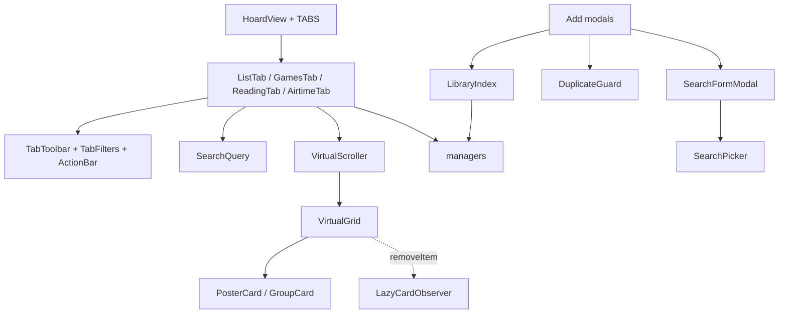

# UI kit

Tabs and modals are thin; shared behaviour lives in `src/ui/` and a few top-level helpers.
**Boundary**: UI depends on the managers, never on storage. Verified by grepping `src/storage/`
imports: outside managers, the import module (`src/import/watchlog/`) and `main.ts`, only `settingsSplit.ts` and `backup.ts`
(settings persistence), `ApiService.ts` (a type) and two pure helpers (`typeNameProblem` behind
`ui/problemText.ts`, `safeTypeName` in the CSV modal) touch it. No tab or modal imports a store, codec or
index.

## HoardView and the TABS registry

[HoardView.ts](../../src/HoardView.ts) holds `TABS` in tab-bar order; a `TabDefinition` has
`create(ctx)` returning a [TabInstance](../../src/ui/TabInstance.ts) (`render`, optional `destroy`),
an optional content class and an optional badge. `HoardView` calls `destroy` whenever it drops the
active instance: on a tab switch, on a UI rebuild (`refreshUI` from the settings) and on view close.
A **tab switch recreates** the instance (state lost); a **data change re-renders the same
instance** in place via `dataManager.onChange`, so filters and expanded rows survive. Badges are
computed without the tab open and refresh on `data-change` (Upcoming) or `metadata-resolved`
(Drafts, needs the vault scan); desktop shows `Label (N)`, mobile a dot. `refreshUI()` (settings)
re-applies the colour theme and rebuilds. On mobile a `ResizeObserver` pins an explicit height on
the tab content because the WebView freezes flex heights when the keyboard opens; while an editor
inside the tab has focus the height is pinned to the smallest value seen and released on focusout.
While the [WatchLog wizard](../flows/watchlog-import.md) is open (`plugin.importRunning`) `renderTabContent` renders only an "import running" line instead of the tab, and data changes re-render that placeholder rather than a tab instance.

## Shared pieces

- **Toolbar** ([TabToolbar.ts](../../src/ui/TabToolbar.ts), [TabFilters.ts](../../src/ui/TabFilters.ts)):
  search box (per-keystroke store, debounced commit re-renders), `renderToolbarCore` (saved
  filter, Filters, Sorting, action bar while a selection exists), filter dropdown building a draft
  per click and committing on Apply, sorting popover, view switch, add button. Selection mode works
  on ids, not DOM, because grids are virtualised. Tabs hand over `registerCleanup` so popover
  document listeners die with the render.
- **Add-modal skeleton**: `SearchFormModal<R>` mounts a `SearchPicker` (debounced search, a
  generation counter drops stale responses, API errors and "no API" render in the results panel)
  above a form; `DuplicateGuard` shows Continue/Cancel and lets one retry pass; `LibraryIndex`
  is built once per modal and matches by [external id](../concepts/external-id.md) first,
  normalised title second, never fuzzy. Sequence: [flows/add-title](../flows/add-title.md).
- **Virtualised grids**: `VirtualScroller` owns the scroll listener, resize observer, section
  offsets and scroll restore for one or more `VirtualGrid`s; each grid diffs the visible row
  window plus two overscan rows through `buildItem` / `removeItem` and offsets with `padding-top`
  (not `transform`, to avoid layout shift). `computeGridMetrics` mirrors the CSS columns;
  `cardSizeToMinWidth` maps the card-size step to a pixel width. `LazyCardObserver` fetches a
  poster the first time a card flagged `data-needs-poster` enters the viewport. `buildPosterCard`
  draws the card; `POSTER_CARD_TEXT_H` must match the CSS. A card built elsewhere reuses its parts:
  `createPosterPlaceholder` (letter tile) and `loadCardPoster` (sets the image, marks the card
  `has-poster` on load, hands a broken image to the caller).
- **Search language** (`searchItems` in [SearchQuery.ts](../../src/SearchQuery.ts)): Fuse index
  over declared fields; bare tokens fuzzy and ANDed, `"quoted"` exact, `field:value` scoped (an
  unknown prefix stays text, so `Re:Zero` works), `field:>n` and friends numeric, `a | b` ORs,
  `-token` excludes. Empty query returns null, meaning "no search". The query is lexed, then turned
  into tokens; `matches` picks one matcher per token: a comparison only on a named field that has a
  number (`title:2049` and a bare `>2020` are searched as text), a phrase when quoted, else fuzzy.
- **Text helpers**: all display text goes through `t()` ([i18n](i18n.md)); shared renderers live in
  `ui/`: `typeBadge`, `choiceGrid` (add choosers), `detailShared` (favourite button, editable title,
  group header, episode-grid text), `detailFrame` (what all three detail modals build alike:
  `markDetailRoot` puts `data-theme`, `hoard-view` and `hoard-detail` on the modal, `createFavoriteButton`
  the footer heart, `mobileRowClass` a row's `--mobile` modifier), `createSeasonHeader` in `EpisodeGrid`
  (season wrap, header and palette-coloured badge of the accordion), `scheduleText` and `dateNames` (localized dates), `problemText`.
- **Form primitives**: rows and cells in `ui/FormCells.ts`, `DatePicker`, `StarRating`,
  `StatusDropdown`, `ConfirmModal`, `StickyModal` (sticky footer in detail modals).
- **Icon buttons** ([IconButton.ts](../../src/ui/IconButton.ts)): `createIconButton(parent,
  { icon, label, cls?, variant? })` builds a `type="button"` with a Lucide icon, `aria-label` and
  tooltip from the same label, base class `hoard-icon-btn` plus `--framed` (bordered) or `--sm`
  (16px inline). **Every icon-only button goes through it**, no text glyphs (`×`, `+`, `⋮`, `↻`);
  the component class in `cls` only adds position or colour. A spinning refresh toggles
  `is-loading`. Drag handles are mouse-only and kept out of the tab order (the custom-list row
  grip is a button with `tabindex=-1`, the column-editor grip a `div`); the trailer button is built
  by hand because it can carry a text label on mobile.

## CSS conventions

- Every class carries the `hoard-` prefix and must appear in full in a source literal, because the
  dead-CSS lint (`pnpm lint`) matches literals; variants go through a spelled-out lookup table
  (see `VARIANT_CLASS` in `IconButton.ts`). See CONTRIBUTING.
- **Naming**: every class follows BEM, `hoard-<block>__<element>--<modifier>`, with abbreviations
  spelled out; states stay `is-*` (`is-active`, `is-loading`). `pnpm lint` enforces it. Blocks, the
  full rules and the ban on inline styles (computed values go through `--hoard-*` custom properties):
  [CSS blocks](css-blocks.md).
- **Beating core button styles**: core's `button:not(.clickable-icon)` outranks a bare
  `.hoard-x`, so button rules are element-qualified (`button.hoard-x`); on tablets
  `.is-tablet button:not(.clickable-icon)` adds 40px side padding and needs an explicit
  `.is-tablet button.hoard-x` reset. `icon-button.css` is imported right after `base.css` so a
  component's own `button.hoard-x` rule wins by source order.
- Tab bars (`hoard-tab-bar` and the settings, reading and inner tab rows) are flat underlined
  buttons; the bar clips overflow instead of scrolling.

## Where to change what

A new tab: a `TabDefinition` in `TABS` plus `TabName`. Shared toolbar, filter or sort behaviour:
`src/ui/`. A new add modal: extend `SearchFormModal`, build a `LibraryIndex` and a
`DuplicateGuard`. Grid geometry: `VirtualGrid.ts` / `VirtualScroller.ts`; card look:
`PosterCard.ts` and the stylesheets in `src/styles/` (one per UI area, imported in cascade order by `index.css`). Search syntax: `SearchQuery.ts` and `SearchHelpModal.ts`.
