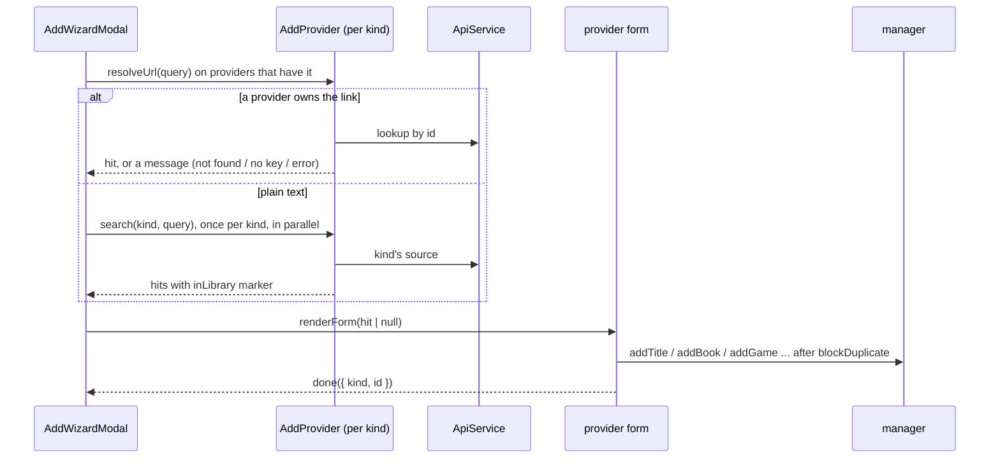

# Add title

Every add, whatever the kind, goes through the one [add wizard](../modules/add.md). Triggers: the `add-title`
command, the add buttons of Watchlist, Reading, Games and Upcoming (Maybe), a Drafts card, a Custom lists row.
The openers differ only in `preferredKinds`, `target` and a prefilled `query`.

## Step 1: search

1. One query field. Typing searches after 600 ms, Enter at once. A generation counter drops every response
   that is not from the latest query or after the dialog closed.
2. **Links first.** If any provider has `resolveUrl`, every section shows "searching" until all have answered. A
   hit opens that provider's form directly (unless a form was opened meanwhile). A link a provider owns that
   fails shows its message in the status line and is **not** searched as text. Owned links: IMDb (link or bare
   `tt…` id), TMDB (needs a TMDB key, else the `nokey` message), MyAnimeList and AniList anime
   ([titleUrl.ts](../../src/modules/watchlist/ui/titleUrl.ts)); MyAnimeList and AniList manga (reading provider). An
   IMDb link carries no kind, so the result's media type decides movie or series.
3. **Search per kind.** Each kind in the dialog calls its provider's `search` independently: sections (anime,
   series, movie, manga, book, game; the caller's `preferredKinds` first) load and fail on their own, an empty one
   hides, a failed one shows `apiErrorMessage`. If every section is empty and none failed, a "No matches" line
   shows. There is no year filter and no paging; a search returns at most `SEARCH_RESULT_LIMIT` rows
   ([api layer](../architecture/api-layer.md)).
4. **Routing for titles** ([watchlistAddProvider.ts](../../src/modules/watchlist/ui/watchlistAddProvider.ts)): the kind
   maps to the Source Type (anime → Anime, movie → Movie, series → Series,
   [sourceType.ts](../../src/shared/domain/sourceType.ts)), and `searchTitles` picks the API: anime via Jikan or
   AniList, else the effective media source (`effectiveMediaSource`: the chosen one if keyed, else keyless Cinemeta),
   so a title search always works without keys.
5. **In-library marker**: the provider builds a `LibraryIndex` per search over its own library (watchlist; books and
   manga separately; games) and marks each hit with `lookup(idKeys, title)`: exact [external id](../concepts/external-id.md)
   first, normalised title second, deliberately not fuzzy.
6. A "Manuell als … hinzufügen" button per kind opens that provider's form with no hit, the query as title.
   Picking a manual entry while a link lookup is pending drops that lookup.

## Step 2: the form

The wizard hides step 1 and mounts `provider.renderForm`; Back destroys the form and shows step 1 as it was.
For titles ([TitleAddForm.ts](../../src/modules/watchlist/ui/TitleAddForm.ts)):

- A picked hit is resolved with `resolvePick` (details, seasons, trailer, credits, poster, anime ids) behind a
  `destroyed` guard so a closed or Back'd form ignores late results. Under Cinemeta the pick carries the poster
  and the trailer lookup result (`recordLookup` after the add, so an empty trailer is not re-asked at once); OMDb and
  TMDB picks leave the poster to the queue ([api layer](../architecture/api-layer.md)).
- `Type` is a plain select (label and folder). Its default follows the kind (Anime, Movie, TV Show); a type missing
  from the settings falls back to the first. The Source Type comes from the kind and is written to the note.
  There is no "last used type" any more.
- Submit needs a name, then `blockDuplicate` ([DuplicateGuard.ts](../../src/design-system/DuplicateGuard.ts)) warns on
  a same-name title (case-insensitive) with Continue/Cancel; Continue lets the next attempt pass once. "To be
  released" is not selectable, it follows the release date. `newTitle`
  ([newTitle.ts](../../src/modules/watchlist/domain/newTitle.ts)) owns the defaults; a `Completed` add marks all episodes
  watched (`completedEpisodes`) and may set the finish date.
- Target `maybe` (Upcoming): the form keeps the media fields and Type but omits status, priority, rating, start date and group, and saves a
  [Maybe note](../concepts/maybe-title.md) through `addMaybeTitle` (no duplicate guard).

Book, manga and game forms follow the same shape ([reading](../modules/reading.md), [games](../modules/games.md));
each runs its own duplicate guard.

## Write

`DataManager.addTitle` creates the note (or takes over a Maybe note), the id becomes the note path, history logs
"added" and the view re-renders ([entry write](entry-write.md)). A community rating is fetched in the background and
a chosen or new group is applied. The form then calls `done({ kind, id })`: the wizard closes and passes it to
`onAdded`. After the `add-title` command, `revealAdded` opens the new watchlist entry's detail (unless
`openWatchlistAfterAdd` is off) and for any other kind only reveals the panel; tab buttons just re-render.

Failure points: API errors render in the failing section (`apiErrorMessage`); an invalid YAML file at the target path
makes the create fail with a Notice.
