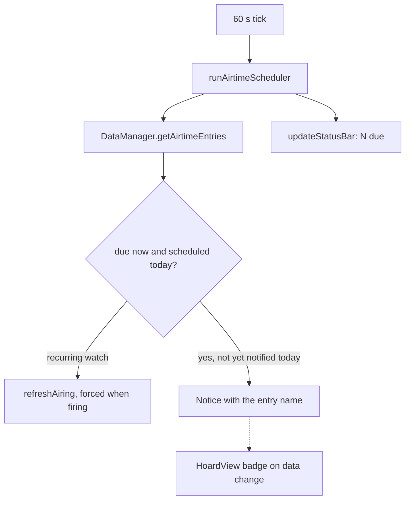

# Airtime notifications

Trigger: `startAirtimeScheduler` in [main.ts](../../src/main.ts) runs one pass at load and every
60 s (`registerInterval`). The Upcoming tab can also tick an entry by hand and calls
`markAirtimeHandled` so the scheduler does not fire twice.

## Steps

1. `runAirtimeScheduler(deps, notified, now)` in
   [airtimeScheduler.ts](../../src/airtimeScheduler.ts) walks every `AirtimeEntry`
   ([airtime](../concepts/airtime.md)).
2. **Due** = today's `HH:MM` has passed at most 12 hours ago (`AIRTIME_CATCH_UP_MINUTES`, catches a
   sleeping machine without a burst after a long sleep) and the recurrence matches today
   (`daily`, `weekly` by `dayOfWeek`, `monthly` by `dayOfMonth`, `once` by date).
3. The key `<entry id>-<YYYY-MM-DD>` in the in-memory `notifiedEntries` set makes each entry fire
   once per day; the set is not persisted.
4. Recurring watch schedules get `DataManager.refreshAiring(titleId, force)` on every pass; force
   only on the firing tick, otherwise the cached `apiCheck.airing` deadline throttles it. This is
   the only API traffic the scheduler causes and it never writes a note.
5. The subject name is resolved per source (title, book or manga, game) and shown as a Notice
   for 8 s.
6. `updateStatusBar` recounts `AirtimeTab.getAiredDueCount + getMaybeDueCount` on every tick and
   on `hoard-data-changed`; desktop only, hidden when the setting is off or the count is 0.
   Clicking opens the Upcoming tab.
7. The Upcoming tab badge uses the same counts via the `TABS` registry (`refreshOn: 'data-change'`).

Failure points: a missing or malformed `releaseTime` never fires; an entry whose subject no longer
exists is skipped silently. Details of the tab: [modules/upcoming](../modules/upcoming.md).
