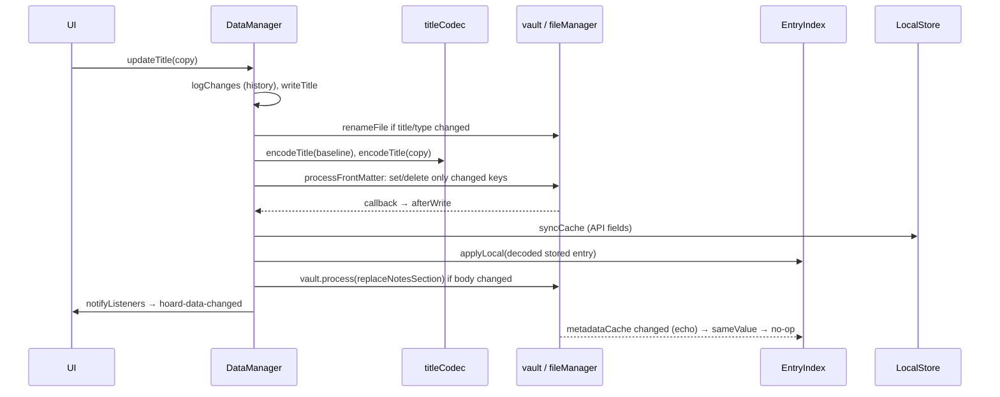

# Entry write

Trigger: a tab or modal mutates its copy of an entry and calls `updateTitle` / `updateBook` /
`updateGame` (or a silent variant plus `save()`). The title path is described; reading and games
follow the same shape in their managers.

## Steps

1. **History first**: `logChanges` compares the copy with the stored title and logs a rating
   change and a change to Completed ([history line](../concepts/history-line.md)); other status
   changes are not logged here.
2. **Rename**: if `title` or `type` differ from the [baseline](../concepts/baseline.md), the note
   moves to `VaultLayout.notePath` (unless the target exists: Notice, old name kept) and `moveId`
   re-keys notes, cache and pending sets and drops the old view slot
   ([entry id](../concepts/entry-id.md)).
3. **Diff and write**: both baseline and copy are encoded; only keys whose JSON differs are set
   or deleted in `processFrontMatter`. Unreadable properties survive. A non-empty season list
   edited by hand sets `seasonsOverride` so it reaches other devices; `seasonsPending` keeps the
   `watched` text untouched while a refill is open ([episode range](../concepts/episode-range.md)).
4. **Inside the callback**, `afterWrite` runs before the write hits disk: `index.applyLocal`
   installs the decoded stored entry, and, only when the copy was based on the stored state,
   `syncCache` stores the API fields in `data.json` ([entry cache](../concepts/entry-cache.md))
   and the copy becomes the live view; a stale copy is discarded on the next read.
5. **Body**: the `## Notes` text is written through `replaceNotesSection` only when the copy
   changed it, so a copy that left the body alone cannot undo a body edit from another device
   (a competing local edit still wins).
6. **Notify**: `notifyListeners` runs manager listeners and dispatches `hoard-data-changed`; the
   view re-renders the active tab in place, widgets and status bar refresh.
7. **Echo**: the vault's `changed` event reaches `EntryIndex.upsert`, which decodes the note and
   finds it deep-equal to what `applyLocal` installed. No second notify.

## Variants

- `updateTitleSilent` + `save()`: batched writes, one notify. Episode toggles use
  `scheduleEpisodeSave` (debounced); `flushPendingSave` on view close and unload.
- Background fills (poster, credits, seasons) pass `background = true`: no `dateModified`
  stamp, no `onLocalWrite` (so they never trigger base creation), no notify.
- `processFrontMatter` on invalid YAML: Notice, write skipped, returns false.
- External edits (sync, hand edit) take the echo path only: `upsert` finds a difference, queues
  the id, and the manager's `index.onChange` notifies and queues missing posters/seasons.
