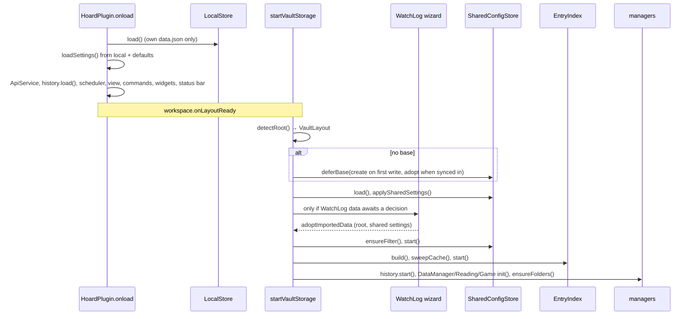

# Startup

Trigger: Obsidian enables the plugin. Two phases in [main.ts](../../src/main.ts): `onload` runs
with only `data.json` (its first call is `setLocale(getLanguage())`, see [i18n](../architecture/i18n.md)), `startVaultStorage` runs once the workspace layout is ready (vault and
metadata cache usable).

## Steps

1. **`LocalStore.load`** reads `data.json` and, when it still holds API keys from an older version, moves them into secret storage and saves right away (migration, see [shared vs local](../concepts/shared-vs-local.md)). A file from a newer plugin version, or a WatchLog
   schema-1 file (no `schemaVersion`, has `titles`) in Hoard's own folder, makes the store read-only
   for the session (such a file is never overwritten; for WatchLog Hoard starts empty); both show a
   sticky Notice, since device settings typed in that session are not saved.
2. **`loadSettings`** composes defaults + local + secret storage (+ shared, empty for now) and mirrors the date
   format into `types.ts`; the card-size CSS variable is set before any grid renders. Then
   `maybeShowSecretsNotice` shows a sticky one-time Notice (flag `hoard-secrets-notice` in
   `app.saveLocalStorage`) when `data.json` carries the `secretsInStorage` marker but this device's
   secret storage is empty: keys do not sync.
3. Services and UI are registered: `ApiService` with the keys, managers get the `HistoryManager`,
   `History.md` is loaded, the 60 s airtime scheduler starts, view, commands, `WidgetRenderer`,
   settings tab and status bar are registered.
4. **`startVaultStorage`**: `detectRoot` (the folder of the first base with `hoard:`, else `Hoard`)
   builds the `VaultLayout`.
5. **Fresh install** (no base): `deferBase` registers a creator; the base is
   written on the first user-initiated note write (`EntryIndex.onLocalWrite` → `ensureBase`) or
   the first changed shared setting, or adopted when a synced base appears (`adoptSyncedBase`: new layout, reload settings, rebuild
   index). This is what lets a second device start on a half-synced vault without becoming the
   first one.
6. Shared config loads and `applySharedSettings` re-composes settings. Then, **before the index is
   built**, `runOnboarding` opens the [WatchLog import](watchlog-import.md) wizard when WatchLog data
   awaits a decision; startup waits until it closes, nothing is indexed meanwhile, and the root and
   shared settings are re-read afterwards. A missing `file.inFolder` filter in the base yields a
   Notice.
7. `EntryIndex.build` scans all notes, `sweepCache` drops cache entries without a note, then the
   index and history start following vault events. Each manager's `init` reads note bodies, hooks
   `index.onChange`, queues missing posters and seasons and notifies once.

## Failure points

- Any error in `startVaultStorage` is caught once: console error plus Notice "could not load its
  notes"; the UI stays up with whatever was loaded before the failure (an already built index is
  not cleared).
- A failing wizard is caught inside `runOnboarding` (console error) and startup continues.
- Type-name changes after start trigger `syncTypeNames` → `index.rebuild()`.

Shutdown (`onunload`) flushes pending debounced note and cache writes synchronously, stops the
index and the shared store, and flushes `LocalStore` last.
