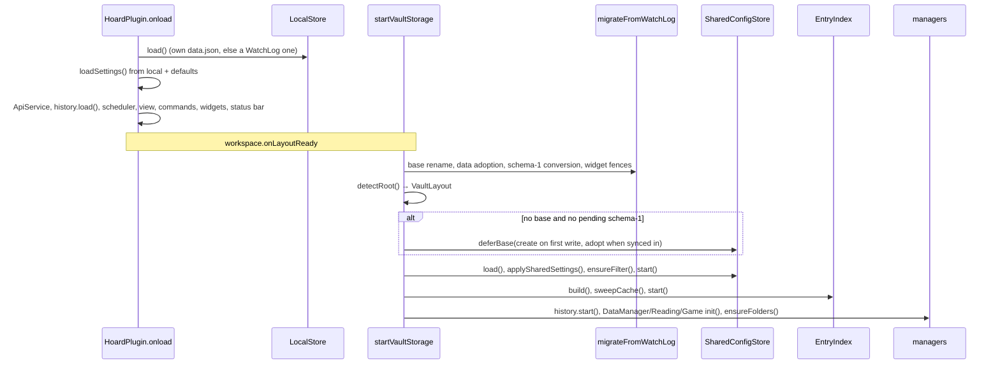

# Startup

Trigger: Obsidian enables the plugin. Two phases in [main.ts](../../src/main.ts): `onload` runs
with only `data.json`, `startVaultStorage` runs once the workspace layout is ready (vault and
metadata cache usable).

## Steps

1. **`LocalStore.load`** reads `data.json` through `loadOwnOrWatchLog`: an empty own file falls
   back to `watchlog-sync` (schema 2, adopted as is) or `watchlog` (schema 1, kept read-only as
   `pendingSchema1`). A file from a newer plugin version makes the store read-only with a Notice.
2. **`loadSettings`** composes defaults + local (+ shared, empty for now) and mirrors the date
   format into `types.ts`; the card-size CSS variable is set before any grid renders.
3. Services and UI are registered: `ApiService` with the keys, managers get the `HistoryManager`,
   `History.md` is loaded, the 60 s airtime scheduler starts, view, commands, `WidgetRenderer`,
   settings tab and status bar are registered. `warnIfWatchLogEnabled` warns when WatchLog is
   still active.
4. **`startVaultStorage`**: [WatchLog import](watchlog-import.md) first, then `detectRoot`. Root
   priority: a base with `hoard:` → the pending schema-1 root folder → `Hoard`.
5. **Fresh install** (no base, nothing pending): `deferBase` registers a creator; the base is
   written on the first user-initiated note write (`EntryIndex.onLocalWrite` → `ensureBase`), or
   adopted when a synced base appears (`adoptSyncedBase`: new layout, reload settings, rebuild
   index). This is what lets a second device start on a half-synced vault without becoming the
   first one.
6. Shared config loads and `applySharedSettings` re-composes settings; a missing
   `file.inFolder` filter in the base yields a Notice.
7. `EntryIndex.build` scans all notes, `sweepCache` drops cache entries without a note, then the
   index and history start following vault events. Each manager's `init` reads note bodies, hooks
   `index.onChange`, queues missing posters and seasons and notifies once.

## Failure points

- Any error in `startVaultStorage` is caught once: console error plus Notice "could not load its
  notes"; the UI stays up with an empty library.
- A failed schema-1 conversion keeps `data.json` as schema 1 and retries next start.
- Type-name changes after start trigger `syncTypeNames` → `index.rebuild()`.

Shutdown (`onunload`) flushes pending debounced note and cache writes synchronously, stops the
index and the shared store, and flushes `LocalStore` last.
