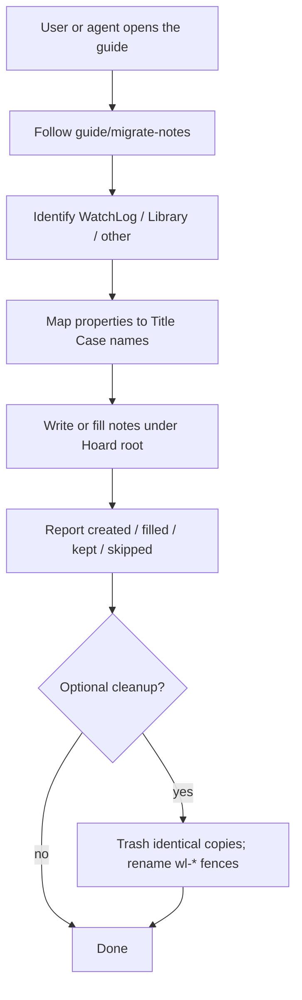

# Migrating from another tracker

Hoard does not offer an import wizard at startup or in settings. Migration is
[guide/migrate-notes/](../../guide/migrate-notes/README.md) ([modules/import](../modules/import.md)).

## WatchLog

- **Original:** `.obsidian/plugins/watchlog/data.json` (schema-1 with `titles[]`); optional `reading.json` /
  `history.json`. Convert records to notes with current property names; never treat that file as
  Hoard's `data.json`.
- **Fork (WatchLog Sync):** notes under a `WatchLog.base` / `watchlog:` root using 0.1 camelCase keys;
  rename keys per the WatchLog reference (same table that used to live in `propertyNames.ts`).

## Library and others

Map field-by-field using [properties](../concepts/properties.md) and the Library reference. Value
forms that differ (rating scale, progress `a/b`, linked genres) must be transformed, not copied blindly.

## Invariants

- Existing Hoard values win (fill missing only).
- Secrets never enter notes or `Hoard.base`.
- Test-vault fixtures omit `External ID` and use `Cover: none` when a real cover would hit the network.
