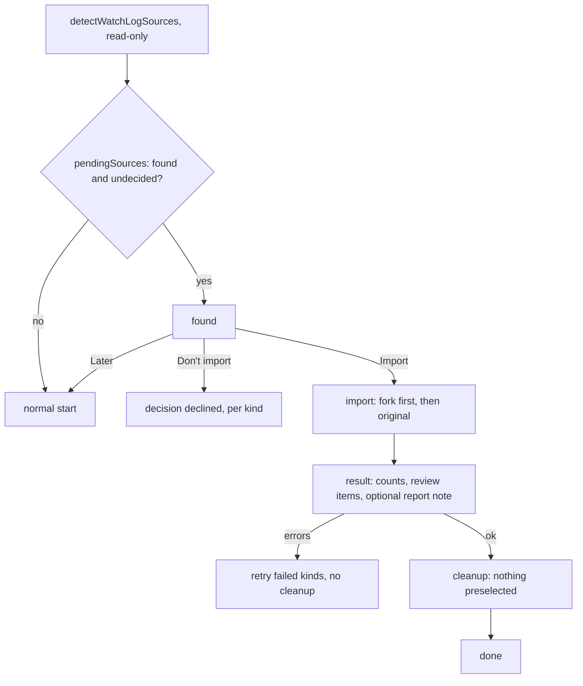

# WatchLog import

Hoard never touches WatchLog data on its own: it starts as a fresh install in its own root and only
*offers* the import. Trigger: `startVaultStorage` ([startup](startup.md)) or the settings entry
`openWatchLogImport`. User-visible behaviour: [README](../../README.md#importing-from-watchlog). Only
`src/import/watchlog/` and the wizard know WatchLog names ([modules/import](../modules/import.md)).

## Detection and start order

- `detectWatchLogSources` finds two independent kinds. **original** = WatchLog: `watchlog/data.json`
  in the plugin folder, schema 1, with a `titles` array. **fork** = WatchLog Sync: the first
  path-sorted `.base` named `WatchLog.base` or holding a top-level `watchlog:` block; its folder is the
  fork root. Type names come from `watchlog.types` (settings sit directly under the key, like
  `hoard:`; a `settings:` level is tolerated), else Hoard's defaults. Notes are counted per managed
  folder; a Hoard root strictly inside the fork root is skipped (`nestedHoardRoot`), a fork nested in
  Hoard's root is counted and copied. Original counts include Maybe titles and custom lists; its `watchlog-sync`
  `data.json` is used only when `schemaVersion === 2`. Also reports `hoardHasData` and whether each
  plugin is still enabled. Broken data is logged and skipped, never thrown.
- `startVaultStorage` runs the wizard **after** the shared config loads and **before**
  `index.build`. While it is open the index, managers and `HoardView` content are not running: views
  show the "import running" placeholder (`importRunning`) and Hoard writes no notes. Afterwards
  `adoptImportedData` re-detects the root (an imported base may have created it) and reloads shared
  settings (API keys reach the `ApiService` there) **before** the placeholder ends, so views render
  with the imported settings; if it fails, a Notice asks for a restart. Startup re-detects the root
  afterwards in any case. A wizard failure is logged and never blocks the start.
- The settings entry (`openWatchLogImport('found' | 'cleanup')`) ignores earlier decisions, stops the
  index, runs the wizard and rebuilds the index afterwards. The cleanup entry appears only when a kind is
  recorded as imported and starts at the cleanup step for those kinds.

## Decisions

Stored per device in `data.json` `ui.watchlogImport[kind]` ([onboardingState.ts](../../src/import/watchlog/onboardingState.ts)):
`imported` or `declined`. A kind is pending while it has no decision.

- **Later** closes the wizard, writes nothing, so the next start asks again.
- **Don't import** records `declined` for every found kind: no further asking on this device.
- A kind is recorded `imported` only when its run finished without errors; a failed kind stays pending
  and is offered for retry.

## Steps

1. **found**: one checkbox per found kind with counts (fork preselected, else original), hints for both
   kinds present, existing Hoard data and a still-enabled plugin.
2. **import**: kinds run in order fork, original, each producing an `ImportReport`
   (`created`, `filled`, `review` items, `errors`). The modal cannot be closed while it runs. Both are
   **copies**: the source is never written and existing Hoard values are never overwritten.
   - *fork* ([importFork.ts](../../src/import/watchlog/importFork.ts)): every file in the managed folders
     plus `History.md` is copied below Hoard's root with its relative path; an existing target is only
     reported (`exists`). Copied entry notes (type, Books, Manga, Games folders) then get their 0.1
     property names translated in place (`translateProperties`, [modules/import](../modules/import.md));
     unreadable YAML is an `invalidYaml` review item, the copy stays. The base is copied with its `watchlog:` block renamed to `hoard:` unless a
     Hoard base exists (reported). Device settings, cache and the draft / reading / games UI state fill
     only what Hoard lacks.
   - *original* ([importOriginal.ts](../../src/import/watchlog/importOriginal.ts)): schema-1 data
     (side files `reading.json` / `history.json` merged for very old installs) goes through
     `importWatchLogData`, which writes notes through the normal codecs: new notes take the body of
     WatchLog's own note when it exists, existing Hoard notes get only missing keys (a differing Hoard
     value is kept and listed as `kept-value`), then groups, airtime, history, base and cache. Custom lists
     are copied. The base is written last, so an interrupted run does not look finished on retry. An
     entry too broken to name its note is reported and skipped; history of a note that failed stays
     plain text instead of linking to it.
   - Both: Watchlist types the source knows and Hoard's base lacks are appended (`registerTypes`,
     matched by name, Hoard's own types and colors stay), so their notes are indexed.
3. **result**: counts per kind, review items (`exists`, `kept-value`, `error`) as links that open the
   file, with a translated detail ([WatchLogReport.ts](../../src/WatchLogReport.ts)), and **Save
   report**: the same content rendered as Markdown in the UI language, with `[path](encoded)` links
   (paths may contain `[`, `]`, `#`), written as `WatchLog-Import YYYY-MM-DD.md` (local date) in Hoard's
   root, numbered when taken. Failed kinds show the errors, a retry button, and block cleanup. One
   failing note is a review item; the rest of the run continues.
4. **cleanup** (`planCleanup` / `runCleanup`, optional, nothing preselected): offers only sources that
   Hoard holds as an **identical copy at another path**. Original notes whose Hoard note has the same
   body (frontmatter lives on in `data.json`); custom lists and fork files whose Hoard copy has the same
   content. A copy kept on import because Hoard's differed (e.g. `History.md`), or one edited since,
   is not offered: the source still holds data. A path that is its own counterpart (WatchLog and Hoard
   share a root) is never offered. Also the fork `WatchLog.base`, only when Hoard's base is its copy (renamed key, folder filter set to
   Hoard's root): a base Hoard already had keeps its own views, so the fork's would be lost. Notes with a
   `watchlog` / `wl-*` fence, which are **renamed** to `hoard` / `hoard-*` instead of trashed. Files go
   to the trash (`trashFile`), then now-empty parent folders up to Hoard's root; a path that became a
   folder is skipped, a folder that cannot go is reported while its note still counts. Errors per file
   are collected, the rest continues. The wizard runs cleanup once (double clicks ignored, Skip disabled
   meanwhile); a failing plan or report save shows a Notice and stays on the result step. Steps without files are not shown.
5. **done**: cleanup result or "skipped", and the hint that the old plugin data goes away by uninstalling
   the plugin. Plugin data of WatchLog is never deleted.
