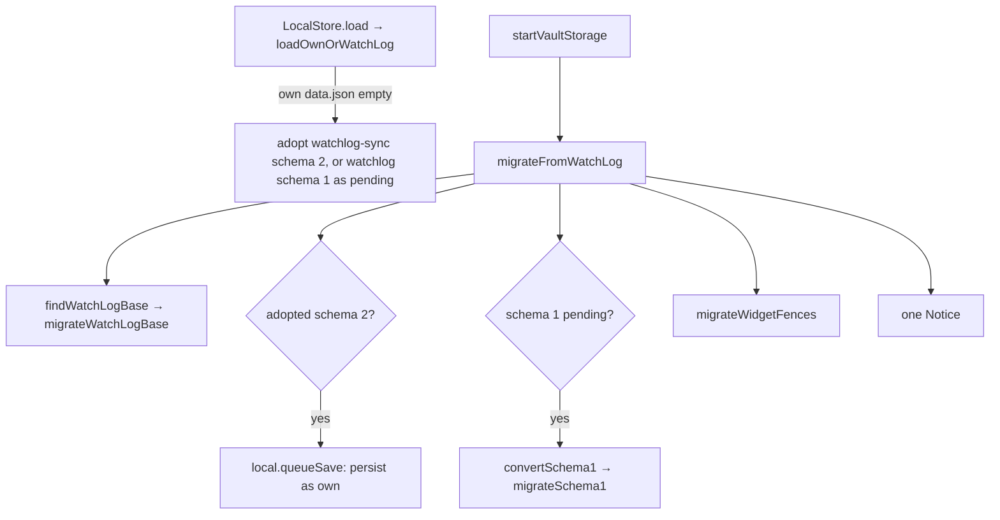

# WatchLog import

Trigger: `startVaultStorage` calls `migrateWatchLog` before root detection
([flows/startup](startup.md)). Only `src/migration/watchlog/` knows WatchLog names; the rest of
the code imports from its index. The README describes the user-visible result.



## Steps

1. **Data adoption at load** (`loadOwnOrWatchLog` in [pluginData.ts](../../src/migration/watchlog/pluginData.ts)):
   while Hoard's own `data.json` is empty, the first non-empty `data.json` of `watchlog-sync` then
   `watchlog` is read. Schema 2 is used as is; schema 1 is kept in memory and `LocalStore` stays
   read-only until converted.
2. **Base file** ([base.ts](../../src/migration/watchlog/base.ts)): the first path-sorted base named
   `WatchLog.base` or holding a top-level `watchlog:` block is rewritten (`renameTopLevelBlock`:
   first block becomes `hoard:`, further ones are removed, everything else byte-identical) and
   renamed to `Hoard.base` in place, so links follow. If a `Hoard.base` already sits beside it, the
   old file is left alone (`blocked`, console warning).
3. **Schema-1 conversion** ([schema1.ts](../../src/migration/watchlog/schema1.ts)): root = folder
   of the first path-sorted base with a `hoard:` block (`detectRoot`, normally the one just
   migrated), else WatchLog's `rootFolder` setting, else `WatchLog`. A copy
   `data.v1-backup.json` is written next to the source first. Titles, books, manga, games become
   notes (`NoteWriter`), groups and airtime are applied, history goes to `History.md`, shared
   settings fill the base, the cache is merged, and a schema-2 `data.json` is built. Every step
   checks current state: **existing note values are never overwritten**, and a second device with
   the same data (`joined`: a `hoard:` base already existed) does not re-add `watched`/`skipped`/`seasons`.
   On any error the report carries it, `data.json` stays schema 1 and the next start retries.
4. **Widget fences** ([widgets.ts](../../src/migration/watchlog/widgets.ts)): every note containing
   a ```` ```watchlog ```` or ```` ```wl-* ```` fence (also indented or quoted) is rewritten to the
   `hoard` names; attributes after the language stay.
5. **Report**: one Notice summarising what was done; skipped items and errors go to the console.
   `migrateFromWatchLog` returns null when nothing WatchLog-related was found, so the vault scan
   for widgets runs only on a start that found WatchLog. A `WatchLog.base` left blocked beside a
   `Hoard.base` is found again on every start and repeats the warning and the scan.

The same converter serves backup restore of WatchLog exports (`importWatchLogData`: no backup
file, no folder moves, schema version untouched). See [modules/import](../modules/import.md).
