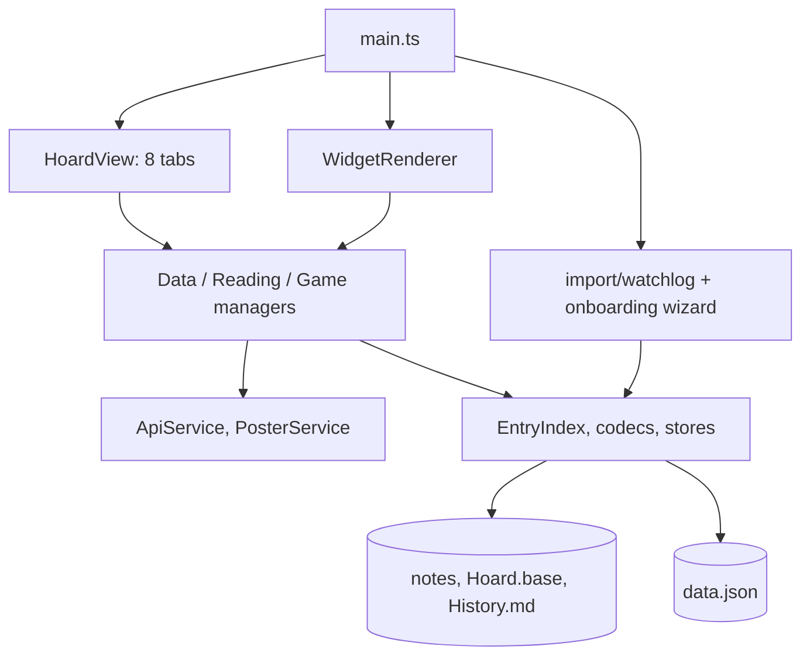

# Context

Hoard is an Obsidian plugin: a media library for movies, TV, anime, books, manga and games, stored
as Markdown notes with properties in the user's vault. A sidebar view with eight tabs, code-block
widgets inside notes, optional API enrichment, and an optional, user-driven import from its predecessor WatchLog.
Read [values](values.md) first; every rule below serves one of them.

- **Entry**: one note = one title, book, manga or game; its id is the note path below the root.
- **Root**: the folder holding `Hoard.base`; type folders and `Books/`, `Manga/`, `Games/` sit below it.
- **Properties**: the YAML block at the top of a note; the only place entry fields live.
- **Base**: `Hoard.base`, whose `hoard:` block carries the shared vocabulary; nothing else syncs settings.
- **Cache**: `data.json`, device-local; API keys, fetched data, UI state.
- **Manager**: `DataManager` (watchlist), `ReadingDataManager`, `GameDataManager`; the writers of entry notes in normal operation (the import wizard writes notes once, custom lists write their own notes).
- **Index**: `EntryIndex`, read-only map from id to decoded entry, fed by vault events.
- **Type**: a user-defined watch kind (Anime, Movie, …) that is also a folder and an API route.
- **Maybe**: a note with `Maybe: true`, considered but not in the library.
- **Airtime**: a schedule on a note (`Airtime …` properties) or a derived "to be released" card.

# Types

The shipped vocabulary only (`Values`, `Domain`, `Architecture`, `Module`, `Flow`). No additions.

# Start here

- [Values](values.md): the hand-written principles every rule in this wiki serves; read before changing behaviour.
- [Testing](../CONTRIBUTING.md#testing) (outside this wiki): which tests exist, the test vault fixtures, and how `pnpm smoke` checks the plugin in a running Obsidian.

# Architecture

- [Overview](architecture/overview.md): which layers exist, who may depend on whom, and what the `hoard-data-changed` event ties together.
- [Storage](architecture/storage.md): where each piece of state lives (notes, base, History.md, data.json) and how reads and writes propagate.
- [API layer](architecture/api-layer.md): which services exist, how errors and rate limits are handled, and how fetched data reaches cache and notes.
- [Internationalisation](architecture/i18n.md): how to add a string, why stored values and storage messages are codes not text, and which tests enforce it.
- [UI kit](architecture/ui-kit.md): how `HoardView` hosts tabs, which shared building blocks (icon buttons included) tabs and modals compose, and the CSS naming rules.

# Modules

- [Watchlist](modules/watchlist.md): what the movies/TV/anime domain does, who owns what, and where to change a title behaviour.
- [Reading](modules/reading.md): how books and manga are modelled, written, imported and exported.
- [Games](modules/games.md): how games are modelled, how Steam sync and cover resolution work.
- [Upcoming](modules/upcoming.md): how the airtime tab derives its entries, counts what is due and writes schedules back.
- [Custom lists](modules/custom-lists.md): how user-defined tables are stored as notes and edited inline, and why a foreign edit is never overwritten.
- [Drafts](modules/drafts.md): how tagged lines in vault notes become add candidates and how the badge is counted.
- [Dashboard](modules/dashboard.md): what the dashboard computes and from which managers.
- [Log](modules/log.md): what the activity log records and how the Log tab reads it.
- [Widgets](modules/widgets.md): how the `hoard-*` code blocks render and stay live.
- [Settings](modules/settings.md): how the settings tab is laid out, what syncs, and how to add a setting.
- [Backup](modules/backup.md): the backup file format, the two export variants and the restore contract.
- [Import](modules/import.md): which module owns WatchLog knowledge, the report and importer contracts, the schema-1 converter, and where a new source goes.

# Flows

- [Startup](flows/startup.md): from plugin load to a ready library, including fresh install, second device and where the import wizard runs.
- [Entry write](flows/entry-write.md): from a user edit to the note on disk without a double render.
- [Add title](flows/add-title.md): from the search box to a new note, with API routing and duplicate guard.
- [Airtime notifications](flows/airtime-notifications.md): how the minute scheduler produces notices, badges and the status bar count.
- [Backup and restore](flows/backup-restore.md): what a backup holds, which copy loses the keys, and the restore order (WatchLog files are not restorable).
- [WatchLog import](flows/watchlog-import.md): the import wizard step by step, when it opens at startup, what Later and Don't import mean, and what cleanup may remove.

# Concepts

- [Property names](concepts/properties.md): the fixed Title Case note property names per medium, naming rules, older names and the 1.0 stability rule.
- [Entry id](concepts/entry-id.md): what an id is, how it maps to a path, what a rename does.
- [Shared vs local](concepts/shared-vs-local.md): which settings sync through the base and which stay in data.json.
- [Entry cache](concepts/entry-cache.md): what data.json keeps per entry and how note and cache merge.
- [External id](concepts/external-id.md): the `External ID` grammar and how it is derived from links and API ids.
- [Episode range](concepts/episode-range.md): the `S01E01-E12` notation and its mapping to absolute episodes.
- [Maybe title](concepts/maybe-title.md): what a Maybe note is and how it is promoted.
- [Airtime](concepts/airtime.md): manual schedules versus derived cards and the acknowledgement rule.
- [Baseline](concepts/baseline.md): how a UI copy remembers its stored state so a write touches only its own changes.
- [History line](concepts/history-line.md): the one-line-per-event format of History.md.

Existing documentation this wiki links instead of repeating: [README](../README.md),
[CONTRIBUTING](../CONTRIBUTING.md), [CLAUDE.md](../CLAUDE.md) and the project skill at
`.claude/skills/project/SKILL.md`.
